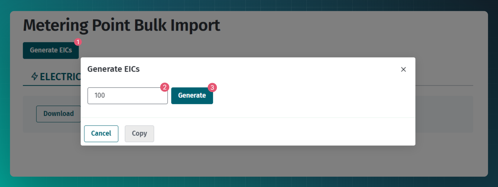
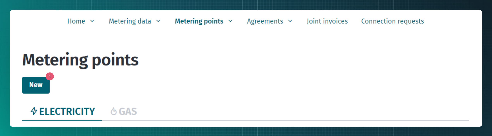
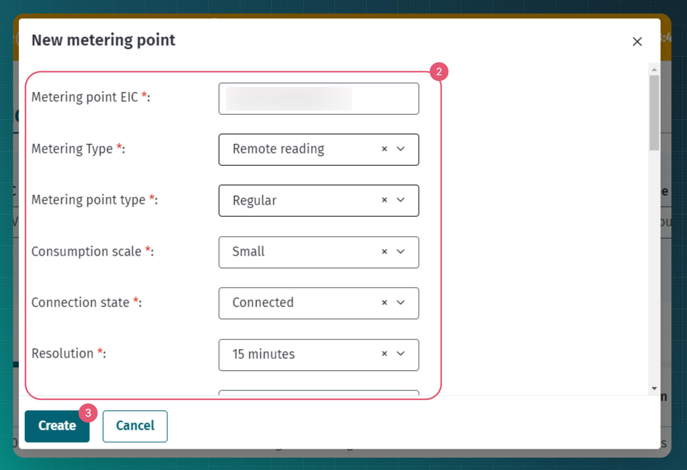
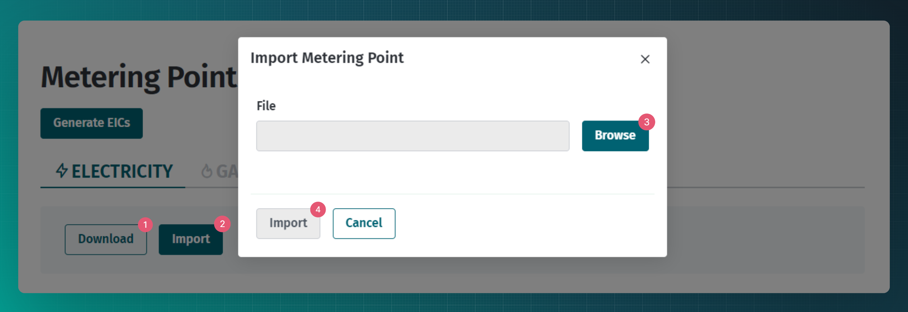
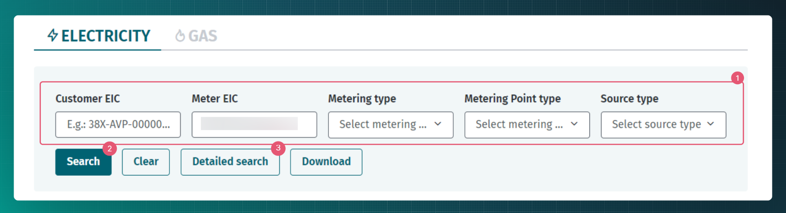
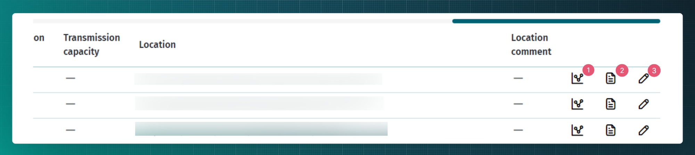

# Metering Points

## Table of Contents

<!-- TOC -->
* [Metering Points](#metering-points)
  * [Table of Contents](#table-of-contents)
  * [Introduction](#introduction)
  * [Submitting Metering Point Data](#submitting-metering-point-data)
    * [General Metering Point API V3 Rules](#general-metering-point-api-v3-rules)
    * [Web interface](#web-interface)
    * [Mass Import of Metering Points](#mass-import-of-metering-points)
    * [EIC Code API Interface Messages](#eic-code-api-interface-messages)
* [Electricity Metering Point API Data Structure](#electricity-metering-point-api-data-structure)
  * [Submitting Electricity Metering Point V3 Data](#submitting-electricity-metering-point-v3-data)
    * [Electricity Metering Point Metadata](#electricity-metering-point-metadata)
    * [Electricity API Messages](#electricity-api-messages)
    * [Electricity GET V3 Search Parameters](#electricity-get-v3-search-parameters)
* [Natural Gas Metering Point API Data Structure](#natural-gas-metering-point-api-data-structure)
  * [Submitting Natural Gas Metering Point V3 Data](#submitting-natural-gas-metering-point-v3-data)
    * [Natural Gas Metering Point Metadata](#natural-gas-metering-point-metadata)
    * [Natural Gas API Messages](#natural-gas-api-messages)
    * [Gas GET V3 Search Parameters](#gas-get-v3-search-parameters)
* [Aggregation Metering Point API Data Structure](#aggregation-metering-point-api-data-structure)
  * [Submitting Aggregation Metering Point V3 Data](#submitting-aggregation-metering-point-v3-data)
    * [Aggregation Metering Point Metadata](#aggregation-metering-point-metadata)
    * [Aggregation API Messages](#aggregation-api-messages)
    * [Aggregation GET V3 Search Parameters](#Aggregation-get-v3-search-parameters)
<!-- TOC -->

## Introduction

> [!WARNING] 
> Important! In Q1 2027, Version 3 (V3) of the metering point APIs will be introduced. Starting from Metering Point API V3, separate APIs will be provided for electricity, natural gas, and aggregation metering points. 
> Metering Point V2 APIs will remain available in parallel for six months after the V3 APIs are introduced. 

A metering point is a device that measures the amount of energy consumed and produced at a given location.

Metering points are managed by the following market participants:

- grid operator;
- line operator;
- closed distribution network operator;
- aggregator;
- producer;
- charging point operator;
- storage operator;
- gas station operator.

For the purpose of this document, they are collectively referred to as **metering point operators**.

Metering point operators are responsible for adding and updating data in the Datahub for the metering points in their area.

> [!WARNING] 
> Important! Metering point operators must update metering point data as soon as possible.

## Submitting Metering Point Data

Metering point operators can submit metering point data to the Estfeed Datahub:

- individually through the web interface or the relevant API interface;
- using mass import via web or API interface

The metering point data structure is the same in both the API services and the web interface.

### General Metering Point API V3 Rules

### General Access Rights and Headers

When using Metering Point API V3, the request context is specified using HTTP headers.

| Header or permission | Description |
|---|---|
| `Authorization` | The request must include a valid JWT token. |
| `x-market-participant-eic` | The EIC code of the market participant on whose behalf the request is made. |
| `x-market-participant-role` | The market role used for the request. |
| `x-commodity-type` | Commodity type. Electricity and Aggregation API `ELECTRICITY`, natural gas API `NATURAL_GAS`. |
| `EDIT_METERING_POINT` | Required when creating or updating a metering point. |
| `VIEW_METERING_POINT` | Required when searching for metering points. |

The permission in the JWT token must be associated with the same combination of market participant EIC, market role, and commodity type as specified in the request headers.

### General Rules for Creating a Metering Point

- The metering point EIC code must be valid and belong to the EIC code range assigned to the requester.
- A metering point with the same EIC code must not already exist in the Estfeed Datahub.
- The metering point owner is determined based on the `x-market-participant-eic` and `x-market-participant-role` headers provided in the request.
- The metering point commodity type must match both the API being used and the value provided in the `x-commodity-type` header.
- The metering point metadata object must match the API being used. Use electricity metadata with the electricity API, natural gas metadata with the natural gas API, and aggregation metadata with the aggregation API.
- When a metering point is created, its creation date and time are set as the start of validity for the new record.

### General Rules for Updating a Metering Point

- The EIC of the metering point to be updated is provided as a path parameter in the PUT request.
- The metering point must exist in the Estfeed Datahub.
- The metering point must belong to the market participant and market role specified in the request headers.
- The metering point EIC code, owner, commodity type, and metering point type cannot be updated with a PUT request.
- A PUT request does not overwrite the existing metering point version. The Datahub creates a new version of the metering point.
- The new version is marked as valid, and the update date and time are set as the start of its validity.
- The validity of the previous version ends at the update date and time.
- New versions of the metadata and location data are created. Previous records are not overwritten.

### General Rules for Metering Point Types and Market Roles

| Metering point | Market roles allowed to create the metering point |
|---|---|
| Electricity `REGULAR` or `INTERNAL` metering point | `GRID_OPERATOR`, `LINE_OPERATOR`, `CLOSED_DISTRIBUTION_NETWORK`, `PRODUCER_OPERATOR`, `CHARGING_POINT_OPERATOR`, `ENERGY_STORAGE_UNIT` |
| Natural Gas `REGULAR` metering point | `GRID_OPERATOR`, `PRODUCER_OPERATOR`, `STORAGE_OPERATOR`, `GAS_STATION_OPERATOR` |
| Electricity or natural gas `BORDER` metering point | `GRID_OPERATOR`|
| `AGGREGATION` metering point | `AGGREGATOR`|

### General Address Data Rules

- `county` must match an active EHAK level 1 unit.
- `municipality` must match an active EHAK level 2 unit and belong to the specified county.
- `locality` is required if the specified municipality has an EHAK level 3 unit.
- If `locality` is provided, it must belong to the specified municipality.
- `streetAddress` contains street, building, apartment, or other ADS level 4–8 data.
- If the correct postcode is unknown, use `00000`.
- When submitting address data as text, use the official names from the EHAK classification.

### General Coordinate Rules

- `coordinates` object is optional.
- If the `coordinates` object is provided, `latitude`, `longitude`, and `coordinateSystem` are required.
- `coordinateSystem` allowed values are `WGS84` and `LEST97`.
- For LEST97, `latitude` must contain seven digits before the decimal separator and 1–3 digits after it.
- For LEST97, `longitude` must contain six digits before the decimal separator and 1–3 digits after it.
- For WGS84, `latitude` and `longitude` must contain two digits before the decimal separator and 4–8 digits after it.
- Coordinate values must be numeric.

### General GET V3 Search Rules

- When several search parameters are used, the conditions are combined with a logical `AND`.
- `viewMode` by default value is `FULL`.
- `hasCustomerAuthorization` by default value is `false`.
- If `hasCustomerAuthorization=true`, only metering points for which the requester has a valid authorization granted through the Customer Portal are returned.
- If `hasCustomerAuthorization=false`, a Customer Portal authorization is not used as a search criterion. Instead, access rules based on metering point ownership, market role, and agreements apply.
- `location.location` enables searching in the combined address text of the metering point.
- `location.comment` enables a partial text search in the location comment.
- `page` value starts from 0.
- The maximum value of `size` is 500.

### General GET V3 Access Rules

Full metering point data is returned if at least one of the following conditions is met:

- the requester is the metering point owner;
- the requester has a valid access authorization granted through the Customer Portal;
- the requester has a valid current or previous agreement associated with the metering point, as permitted by the access rules;
- the requester has a future agreement associated with the metering point, and the API-specific and commodity-specific conditions are met;
- as the owner of the parent metering point, the requester has access to the child metering point data;
- the requester has access as an aggregator through an aggregation agreement or through an aggregation metering point owned by the requester.

If none of the access conditions apply, full metering point data is not returned. For the customer-based agreement creation service, only the metering point EIC may be returned instead of full data.

### General V3 Response Data

The V3 service response may contain the following data:

| Attribute | Description |
|---|---|
| `eic` | Metering point EIC code. |
| `commodityType` | Metering point commodity type. |
| `meteringPointType` | Metering point type. |
| `meteringType` | Metering method. |
| `owner` | Metering point owner data, including EIC code and market role. |
| `customer` | The customer associated with a valid agreement, if returning customer data is permitted by the access rules. |
| `characteristics` | Commodity-specific or aggregation-specific metadata. |
| `location` | Metering point location data. |

After successful processing, the POST and PUT services return the created or updated metering point data. If an error occurs, a standard error response is returned.

### Paginated GET Response

The GET search response is paginated. It contains at least the following pagination data:

| Attribute | Description |
|---|---|
| `content` | List of metering points found. |
| `page` | number of the returned page. |
| `size` | Page size. |
| `totalElements` | Total number of records matching the search criteria. |
| `totalPages` | Total number of pages in the search result. |

### Web interface

When needed, it is possible to generate a new available EIC code via the web interface by navigating to the “Metering points” -> “Metering Point Mass Import” page. You need to specify the number of EIC codes needed.

There are two options for adding metering points in the web interface:

- one by one
- using mass import

For one by one importing you need to navigate to the "Metering points" page.

1. Click the "New" button.
2. Fill in all mandatory fields (marked with an asterisk) in the modal window.
3. If the “Create” button is inactive, there might be an unfilled mandatory field.

Metering point mass import is possible by navigating to "Metering points" -> "Metering Point Mass Import" page and using a MS Excel file.

1. Download the template.
2. Use the “Import” button to open the modal window.
3. Add the data-filled file containing the metering point(s).

On the "Metering points" page it is possible to use the search functionality to find the needed metering points.

1. If needed 1 or more search requirements can be added.
2. Without any search requirements all metering points are shown. Otherwise, the results are shown based on the given search requirements.
3. It is possible to use more search categories by opening the detailed search.

From the metering point results it is possible to:
1. view the metering point metering data;
2. view the metering point agreements;
3. change the metering point data.

The described functionalities are for market participants who manage metering points, other roles do not have the possibility to edit the data.

### Mass Import of Metering Points

Both the web interface and the API interface support mass import of metering points using an MS Excel file. Download the commodity-specific template through the web interface or the `template` service, add the data, and import the completed template through the web interface or the `import` service.

The metering point data structure is described together with the APIs in the following sections:
- Electricity: [Electricity Metering Point API Data Structure](#electricity-metering-point-api-data-structure)
- Gas: [Natural Gas Metering Point API Data Structure](#natural-gas-metering-point-api-data-structure)
- Aggregation: [Aggregation Metering Point API Data Structure](#aggregation-metering-point-api-data-structure)

### EIC Code API Interface Messages

#### Messages

| Message                      | Purpose                                             |
|-------------------------------|-----------------------------------------------------|
| `POST /api/v1/eic/amount`                            | Search for available EIC codes in the market participant’s **own** EIC range.   |
| `POST /api/v1/eic/range`                        | Search for the market participant’s **own** EIC code ranges.       |

# Electricity Metering Point API Data Structure

## Submitting Electricity Metering Point V3 Data

### General Data

| API attribute | V2 | V3 | Comment |
|-------------------|----|----|------------|
| eic | yes | yes | Metering point EIC code |
| meteringPointType | yes | yes | Metering point type |
| meteringType | yes | yes | Metering method |
| characteristics | yes | yes | Electricity Metering Point Metadata |
| location | yes | yes | Metering point location data |

### Electricity Metering Point Metadata

| API attribute | Required in V2? | Required in V3? | Other rules |
|-------------------|---------------------------|---------------------------|-------------|
| consumptionScale | yes | yes | SMALL, LARGE |
| connectionState | yes | yes | CONNECTED, DISCONNECTED |
| resolution | yes | yes | V2: PT15M (15 minutes), PT1H (1 hour), V3: 15_MINUTES  |
| customerType | yes | yes | One of: `CONSUMER` (consumer), `GRID_OPERATOR` (grid operator), `PRODUCER` (producer), `MICRO` (micro-producer), `LINE_OPERATOR` (line operator), `ENERGY_STORAGE_UNIT` (energy storage unit), `CHARGING_POINT_OPERATOR` (charging point operator). |
| production | yes | yes | TRUE/FALSE |
| apartmentAssociation | yes | yes | TRUE/FALSE |

### Electricity-Specific Metering Point Metadata

| API attribute | Column name in the mass import template | Description | Required in V2? | Required in V3? | Other rules |
|---|---|---|---|---|---|
| productionSource | Production Source | Energy production source | yes, if `production=true` | yes, if `production=true` | One of: `SOLAR` (solar), `WIND` (wind), `HYDRO` (hydro), `BIOGAS` (biogas), `BIOMASS` (biomass), `NATURAL_GAS` (natural gas), `OIL_SHALE` (oil shale), `OTHER_RENEWABLE` (other renewable), `OTHER_NON_RENEWABLE` (other non-renewable). |
| transmissionNetworkEic | Transmission Network EIC | 16-character transmission network EIC code | yes | no | The specified transmission network EIC code must exist in the system. Its commodity type must match the metering point commodity type. If the code is unavailable, `38A-1234567890-1` may be used. This attribute is optional in V3. |
| isolatedMeteringPoint | Isolated Metering Point | Indicates whether this is an isolated metering point | yes | yes | One of: `TRUE` (yes), `FALSE` (no). |
| electricalHeating | Electrical Heating | Indicates whether electric heating is used at the metering point | yes | yes | One of: `TRUE` (yes), `FALSE` (no). |
| chargingPoint | Charging Point | Indicates whether electricity charging takes place at the metering point | yes | yes | One of: `TRUE` (yes), `FALSE` (no). |
| storageCapacity | Storage Capacity | Energy storage capacity (kW) | yes | yes | Must be an integer or decimal number with no more than two decimal places. |
| storageEnergy | Storage Energy | Energy storage capacity (kWh) | yes | yes | Must be an integer or decimal number with no more than two decimal places. |
| productionCapacity | Production Capacity | Production capacity (kW) | yes | yes | Must be an integer or decimal number with no more than two decimal places. |
| transmissionCapacity | Transmission Capacity | Transmission capacity (kW) | yes | yes | Must be an integer or decimal number with no more than two decimal places. |
| esuScheme | ESU Scheme | Energy storage scheme | attribute not available | no | One of: `STANDALONE` (standalone storage), `PRODUCTION` (storage and production), `CONSUMPTION` (storage and consumption), `HYBRID` (storage, production, and consumption). May be provided only for metering points of type `REGULAR` or `BORDER`. May be provided only when the market role specified in the `x-market-participant-role` header is `GRID_OPERATOR` or `CLOSED_DISTRIBUTION_NETWORK`. |
| esuSchemeValidFrom | ESU Scheme Valid From | Date from which the energy storage scheme is valid | attribute not available | conditional | Must be provided as an ISO 8601 date in the `yyyy-MM-dd` format. The date is interpreted as the start of the day in the `Europe/Tallinn` time zone. |
| esuQuantitiesProvider | ESU Quantities Provider | Provider of energy storage metering data | attribute not available | conditional | One of: `OWNER` (owner), `CUSTOMER` (metering point customer). Required when `esuScheme=HYBRID`. Must not be provided when `esuScheme` is not `HYBRID`. |
| esuBilling | ESU Billing | Indicates whether the energy storage billing scheme is used | attribute not available | conditional | One of: `TRUE` (yes), `FALSE` (no). Required when `esuScheme` is provided. |
| esuBillingValidFrom | ESU Billing Valid From | Date from which the energy storage billing scheme is valid | attribute not available | conditional | Start date of the energy storage billing scheme, specified to the day. |
| bidirectional | Bidirectional | Indicates whether the metering point is bidirectional | attribute not available | conditional | One of: `TRUE` (yes), `FALSE` (no). May be provided only when the market role specified in the `x-market-participant-role` header is `GRID_OPERATOR` or `CLOSED_DISTRIBUTION_NETWORK`. |
| bidirectionalChangeTime | Bidirectional Change Time | Date and time when the bidirectional status changes | attribute not available | conditional | Required when the value of `bidirectional` changes. The time must use 15-minute intervals. The minute value must be `00`, `15`, `30`, or `45`, and the second value must be `00`. |

### Location Data

| API attribute | Required in V2? | Required in V3? | Comment |
|-------------------|---------------------------|---------------------------|------------|
| adrId | no | no | ADS address identifier |
| comment | no | no | Comment |
| county | yes | yes | County. Must match an EHAK level 1 unit. |
| municipality | yes | yes | Municipality. Must match an EHAK level 2 unit and belong to the specified EHAK level 1 unit. |
| locality | no | conditional | Required in V3 if an EHAK level 3 unit exists. The value must belong to the specified EHAK level 2 unit. |
| streetAddress | yes | yes | Street, building and apartment (ADS levels 4-8) |
| postcode | yes | yes | Postcode |
| coordinates | no | no | Coordinates |

#### Coordinates

| API attribute | Required in V2? | Required in V3? | Comment |
|-------------------|---------------------------|---------------------------|------------|
| latitude | yes, if coordinates is provided | yes, if coordinates is provided | Latitude |
| longitude | yes, if coordinates is provided | yes, if coordinates is provided | Longitude |
| coordinateSystem | yes, if coordinates is provided | yes, if coordinates is provided | WGS84 or LEST97 |

### Attributes Added in V3

| Attribute | Description |
|-----------|-----------|
| esuScheme | Energy storage scheme |
| esuSchemeValidFrom | Date when the energy storage scheme takes effect |
| esuQuantitiesProvider | Provider of energy storage quantity data |
| esuBilling | Energy storage billing scheme |
| esuBillingValidFrom | Date when the energy storage billing scheme takes effect |
| bidirectional | Indicates whether the metering point is bidirectional |
| bidirectionalChangeTime | Time of the bidirectional status change |

### Rules Changed in V3

| Attribute | Change |
|-----------|----------|
| transmissionNetworkEic | Required → optional |
| resolution | Uses only the `15_MINUTES` enum value. |
| API structure | The general metering point API was divided into separate electricity, natural gas, and aggregation APIs. |

### Electricity API Messages 

| Message | Purpose |
|---|---|
| `POST /api/v3/metering-points/electricity` | Create an electricity metering point. |
| `PUT /api/v3/metering-points/electricity/` | Update an electricity metering point. |
| `GET /api/v3/metering-points/electricity` | Search for electricity metering points. The EIC code can be provided as a query parameter when needed |
| `GET /api/v3/customers/{customerEic}/metering-points/electricity` | Search for the customer’s electricity metering points during the process of creating a new agreement. |

### Electricity API Usage Rules

- `x-commodity-type` must be `ELECTRICITY`.
- The Electricity API supports the electricity metering point data.
- The metering point type must be one of the types allowed by the electricity API.
- Aggregation metering points cannot be created or updated through the electricity metering point API. Use the separate aggregation API.
- The Electricity GET service does not return aggregation metering points.
- `resolution` V3 value is `15_MINUTES`.
- `transmissionNetworkEic` is not required.
- If `production=true`, `productionSource` is required.

### Electricity GET V3 Search Parameters

`GET /api/v3/metering-points/electricity` supports the following search parameters:

| Parameter | Required | Rule |
|---|---|---|
| `eic` | no | Metering point EIC code. The metering point must exist in the Datahub. |
| `meteringPointType` | no | Allowed subset: `REGULAR`, `BORDER`, `INTERNAL`. |
| `meteringType` | no | Metering method. |
| `customerEic` | no | The customer must exist in the Datahub. Returns metering points where the customer has an active `GRID` agreement. |
| `viewMode` | no | The default value is `FULL`. |
| `hasCustomerAuthorization` | no | False by default. If set to `true`, only metering points covered by a valid customer authorization are returned. |
| `consumptionScale` | no | Consumption scale. |
| `connectionState` | no | Connection state. |
| `resolution` | no | The Electricity V3 value is `15_MINUTES`. |
| `customerType` | no | Electricity metering point customer type. |
| `production` | no | Indicates whether production takes place at the metering point. |
| `productionSource` | no | Production source. |
| `transmissionNetworkEic` | no | The transmission network EIC must exist in the Datahub, and its commodity type must match the metering point commodity type. |
| `apartmentAssociation` | no | Indicates whether the metering point is associated with an apartment association. |
| `isolatedMeteringPoint` | no | Indicates whether this is an isolated metering point. |
| `electricalHeating` | no | Indicates whether electric heating is used at the metering point. |
| `chargingPoint` | no | Indicates whether this is a charging point. |
| `storageCapacity.filterType` | conditional | Storage capacity filter type. Required if `storageCapacity.filterValue` is provided. |
| `storageCapacity.filterValue` | conditional | Storage capacity filter value in kW. Required if `storageCapacity.filterType` is provided. |
| `storageEnergy.filterType` | conditional | Energy storage capacity filter type. Required if `storageEnergy.filterValue` is provided. |
| `storageEnergy.filterValue` | conditional | Energy storage capacity filter value in kWh. Required if `storageEnergy.filterType` is provided. |
| `productionCapacity.filterType` | conditional | Production capacity filter type. Required if `productionCapacity.filterValue` is provided. |
| `productionCapacity.filterValue` | conditional | Production capacity filter value in kW. Required if `productionCapacity.filterType` is provided. |
| `transmissionCapacity.filterType` | conditional | Transmission capacity filter type. Required if `transmissionCapacity.filterValue` is provided. |
| `transmissionCapacity.filterValue` | conditional | Transmission capacity filter value in kW. Required if `transmissionCapacity.filterType` is provided. |
| `esuScheme` | no | Energy Storage Unit scheme. |
| `esuQuantitiesProvider` | no | Defines who provides the Energy Storage Unit quantities. |
| `esuBilling` | no | Defines whether quantities are billed according to storage unit billing rules or standard billing rules. `false` or `true` |
| `bidirectional` | no | Indicates whether the metering point is bidirectional. |
| `location.adrId` | no | ADS address identifier. |
| `location.location` | no | Partial search in the combined address formed from ADS levels 1–8. |
| `location.comment` | no | Partial search in the location comment. |
| `page` | no | Page number. Numbering starts from zero. |
| `size` | no | Page size. The maximum value is 500. |

#### Electricity GET V3 Access Rules

If `hasCustomerAuthorization=true`, are returned only metering points,
for which the requester is Customer Portals granted valid authorization.

If `hasCustomerAuthorization=false`, market-role-based rules apply:

- `GRID_OPERATOR`, `LINE_OPERATOR`, `CLOSED_DISTRIBUTION_NETWORK`,
  `PRODUCER_OPERATOR`, `CHARGING_POINT_OPERATOR` and
  `ENERGY_STORAGE_UNIT` can view metering points that it owns.;
- `AGGREGATOR` access depends on an active aggregation agreement associated with the metering point;
- `OPEN_SUPPLIER` access depends on active open supply agreements associated with the metering point and other applicable access rules.
- If `customerEic` is provided, the service returns metering points for which the customer has an active `GRID` agreement at the time of the request.
- The service returns only electricity metering points. `AGGREGATION` type metering points are not returned.

#### Electricity Customer-Based Search

`GET /api/v3/customers/{customerEic}/metering-points/electricity` is a dedicated service used in the process of creating a new agreement.

- service uses `OPEN_SUPPLIER` or `AGGREGATOR` role.
- The user must have the `VIEW_METERING_POINT` permission.
- `x-commodity-type` must be `ELECTRICITY`.
- The service searches for the customer’s electricity metering points by customer EIC.
- The service searches for the customer’s metering points where the customer has an active or future `GRID` or `BORDER_GRID` agreement;
- full data is returned if the open supplier currently has, or had during the previous 12 months, a `SUPPLY` or `GENERAL_SERVICE` agreement, or if there is a valid customer authorization. Otherwise, only the EIC is returned;
- full data is returned if the requester has access to the metering point under the standard access rules.
- If full access is not available, the service may return only the metering point EIC for the agreement creation check.
- in V3 services are returned only `GRID_OPERATOR` or `CLOSED_DISTRIBUTION_NETWORK` ownerships metering points.

#### Version Information

The following changes were introduced in V3:
  - V3 adds seven new attributes to electricity metering points: `esuScheme`, `esuSchemeValidFrom`, `esuQuantitiesProvider`, `esuBilling`, `esuBillingValidFrom`, `bidirectional`, and `bidirectionalChangeTime`.
  - V3 changes the mandatory-field rules for location attributes and electricity-specific metering point attributes.
  
# Natural Gas Metering Point API Data Structure

## Submitting Natural Gas Metering Point V3 Data

### General Data

| API attribute | V2 | V3 | Comment |
|-------------------|----|----|------------|
| eic | yes | yes | Metering point EIC code. In a V3 PUT request, the EIC code is provided as a path parameter. |
| meteringPointType | yes | yes | Metering point type. Allowed values are `REGULAR` and `BORDER`. |
| meteringType | yes | yes | Metering method. |
| characteristics | yes | yes | Natural Gas Metering Point Metadata. |
| location | yes | yes | Metering point location data. |

### Natural Gas Metering Point Metadata

| API attribute | Required in V2? | Required in V3? | Other rules |
|-------------------|----------------------------|----------------------------|--------------|
| consumptionScale | yes | yes | SMALL, LARGE |
| connectionState | yes | yes | CONNECTED, DISCONNECTED |
| resolution | yes | yes | V2: `PT1H` (1 hour), `PT1D` (1 day). V3: `HOUR`, `DAY`. |
| customerType | yes | yes | One of: `CONSUMER`, `CONSUMER_2`, `GRID_OPERATOR`, `PRODUCER`, `PROTECTED`, `PROTECTED_OTHER`, `GENERAL_INTEREST_SERVICE_PROVIDER`, `POWER_PRODUCER_FROM_GAS`. |
| production | yes | yes | TRUE/FALSE |
| apartmentAssociation | yes | yes | TRUE/FALSE |

The V3 API uses a separate `NaturalGasMeteringPointResolution` enum for natural gas metering points. Values are converted in the Datahub as follows:
- `HOUR` ↔ `PT1H`;
- `DAY` ↔ `PT1D`.

### Location Data

| API attribute | Required in V2? | Required in V3? | Comment |
|-------------------|----------------------------|----------------------------|------------|
| adrId | no | no | ADS address identifier. |
| comment | no | no | Comment. |
| county | yes | yes | County. Must match an active EHAK level 1 unit. |
| municipality | yes | yes | Municipality. Must match an active EHAK level 2 unit and belong to the specified county. |
| locality | no | conditional | Required in V3 if the specified municipality has an EHAK level 3 unit. The value must belong to the specified municipality. |
| streetAddress | yes | yes | Street, building, apartment, or other ADS levels 4–8. |
| postcode | yes | yes | Postcode. If the correct postcode is unknown, use `00000`. |
| coordinates | no | no | Coordinates. |

#### Coordinates

| API attribute | Required in V2? | Required in V3? | Comment |
|-------------------|----------------------------|----------------------------|------------|
| latitude | yes, if coordinates is provided | yes, if coordinates is provided | Latitude. |
| longitude | yes, if coordinates is provided | yes, if coordinates is provided | Longitude. |
| coordinateSystem | yes, if coordinates is provided | yes, if coordinates is provided | WGS84 or LEST97. |

### Rules Changed in V3

| Attribute | Change |
|----------|----------|
| API structure | The general metering point API was divided into separate electricity, natural gas, and aggregation APIs. |
| sourceType | The attribute was removed. Access is determined based on the market role, metering point ownership, agreements, and customer authorizations. |
| resolution | V3 uses a separate natural gas metering point resolution enum with the values `HOUR` and `DAY`. |
| locality | Required in V3 if the specified municipality has an EHAK level 3 unit. |
| Location data validation | county, municipality, and locality are validated against the active EHAK classification. |

### Natural Gas API Messages

| Message | Purpose |
|---|---|
| `POST /api/v3/metering-points/natural-gas` | Create a natural gas metering point. |
| `PUT /api/v3/metering-points/natural-gas/` | Update a natural gas metering point. |
| `GET /api/v3/metering-points/natural-gas` | Search for natural gas metering points. |
| `GET /api/v3/customers/{customerEic}/metering-points/natural-gas` | Search for the customer’s natural gas metering points during the process of creating a new agreement. |

### Natural Gas API Usage Rules

- `x-commodity-type` must be `NATURAL_GAS`.
- `BORDER` type natural gas metering point can be created only by `GRID_OPERATOR`.
- `REGULAR` type natural gas metering point can be created by `GRID_OPERATOR`, `PRODUCER_OPERATOR`, `STORAGE_OPERATOR` and `GAS_STATION_OPERATOR`.
- Natural Gas GET service returns only `NATURAL_GAS` metering points.
- The Natural Gas GET service does not return metering points of type `AGGREGATION`.
- The allowed Natural Gas V3 resolution values are `HOUR` and `DAY`.
- in the Datahub `HOUR` corresponds to `PT1H` and `DAY` corresponds to `PT1D`.

#### Gas GET V3 Search Parameters

`GET /api/v3/metering-points/natural-gas` supports the following search parameters:

| Parameter | Required | Rule |
|---|---|---|
| `eic` | no | Metering point EIC code. The metering point must exist in the Datahub. |
| `meteringPointType` | no | Metering point type. Allowed values are `REGULAR` and `BORDER`. |
| `meteringType` | no | Metering method. |
| `customerEic` | no | Customer EIC code. The customer must exist in the Datahub. Returns metering points where the customer has an active `GRID` agreement at the time of the request. |
| `viewMode` | no | Response view mode. The default value is `FULL`. |
| `hasCustomerAuthorization` | no | The default value is `false`. If set to `true`, only metering points for which the requester has a valid authorization granted through the Customer Portal are returned. |
| `consumptionScale` | no | Consumption scale. Allowed values are `SMALL` and `LARGE`. |
| `connectionState` | no | Connection state. Allowed values are `CONNECTED` and `DISCONNECTED`. |
| `resolution` | no | Metering data resolution. Allowed values are `HOUR` and `DAY`. |
| `customerType` | no | Natural gas metering point customer type. |
| `production` | no | Indicates whether natural gas is produced at the metering point. |
| `apartmentAssociation` | no | Indicates whether the metering point is associated with an apartment association. |
| `location.adrId` | no | ADS address identifier of the Estonian Land and Spatial Development Board. |
| `location.location` | no | Allows a partial search in the combined address formed from ADS levels 1–8. |
| `location.comment` | no | Allows a partial text search in the location comment. |
| `page` | yes | Page number. Page numbering starts from zero. Use `n+1` to request the next page. |
| `size` | yes | Page size. The maximum value is 500. |

When several search parameters are used, the conditions are combined with a logical `AND`.

### Natural Gas GET V3 Access Rules

If `hasCustomerAuthorization=true`, are returned only metering points, for which the requester has a valid authorization granted through the Customer Portal.

If `hasCustomerAuthorization=false`, at least the following principles apply:

- `GRID_OPERATOR`, `PRODUCER_OPERATOR`, `STORAGE_OPERATOR` and `GAS_STATION_OPERATOR` can view the natural gas metering points they own;
- `OPEN_SUPPLIER` access depends on supply agreements associated with the metering point and other applicable access rules;
- natural gas metering points are not returned to an aggregator under the standard aggregation access logic;
- returning full data depends on metering point ownership, a valid authorization, or agreement-based access.

#### Natural Gas Customer-Based Search

`GET /api/v3/customers/{customerEic}/metering-points/natural-gas` is a dedicated service used in the process of creating a new agreement.

- service uses `OPEN_SUPPLIER` role.
- The user must have the `VIEW_METERING_POINT` permission.
- `x-commodity-type` must be `NATURAL_GAS`.
- The service searches for the customer’s natural gas metering points by customer EIC.
- Full data is returned if the open supplier currently has, or had during the previous 12 months, a `SUPPLY` or `GENERAL_SERVICE` agreement, or if there is a valid customer authorization. Otherwise, only the EIC is returned;
- Full data is returned if the requester has access to the metering point under the standard access rules.
- If full access is not available, the service may return only the metering point EIC for the agreement creation check.
- The V3 service returns only metering points owned by a `GRID_OPERATOR` or `CLOSED_DISTRIBUTION_NETWORK`.
#### Version Information

The following changes were introduced in V3:
- A separate `NaturalGasMeteringPointResolution` enum was added for natural gas metering points;
- The `sourceType` attribute was removed from the V3 API;
- The EHAK-based location data validation rules were clarified.

# Aggregation Metering Point API Data Structure

An aggregation metering point is an electricity metering point whose type is always `AGGREGATION`. When using the API, `x-commodity-type` must be `ELECTRICITY` and the market role must be `AGGREGATOR`.

The full guide for adding aggregation metering points is available [here](https://elering.ee/sites/default/files/2026-06/Iseseisva%20agregaatori%20reguleerimisandmete%20esitamise%20juhend%20Estfeed%20Datahubis.pdf).

## Submitting Aggregation Metering Point V3 Data

### General Data

| API attribute | V2 | V3 | Comment |
|-------------------|----|----|------------|
| eic | yes | yes | Metering point EIC code. In a V3 PUT request, the EIC code is provided as a path parameter. |
| meteringPointType | yes | set by the API | The value is always `AGGREGATION` and is not included in the POST or PUT request body. |
| meteringType | yes | yes | Metering method. |
| characteristics | yes | yes | Aggregation Metering Point Metadata. |
| location | yes | yes | Metering point location data. |

In a POST request, `eic` must belong to the EIC range assigned to the aggregator, and a metering point with the same EIC must not already exist in the system.  
In a PUT request, the metering point specified in the URL must exist, belong to the requester, have the commodity type `ELECTRICITY`, and have the metering point type `AGGREGATION`.

### Aggregation Metering Point Metadata

| API attribute | Required in V2? | Required in V3 POST? | V3 PUT rule | Other rules |
|-------------------|----------------------------|-------------------------|---------------|--------------|
| parentMeteringPointEic | yes | yes | It is not included in the PUT request body and cannot be updated. | Must refer to a `REGULAR` metering point registered in the system and owned by a `GRID_OPERATOR` or `CLOSED_DISTRIBUTION_NETWORK`. The parent metering point must use the same commodity type. |
| aggregationProductType | yes | yes | The value may be added only if no previous value exists. | One of: `MFRR`, `AFRR`, `FCR`, `D1`, `D`, `LOCAL_PRODUCT`. |
| assetType | yes | yes | The value may be added only if no previous value exists. | CONSUMPTION or PRODUCTION. |
| aggregationProductionType | yes, if assetType=PRODUCTION | yes, if assetType=PRODUCTION | The value may be added only if no previous value exists. | Allowed only when `assetType=PRODUCTION`. One of: `BESS`, `BV`, `WIND`, `HYDRO`, `OTHER`. |
| resourceEic | yes | yes | The value may be added only if no previous value exists. | The resource EIC code must follow the EIC format and belong to the aggregator. |

### Location Data

| API attribute | Required in V2? | Required in V3? | Comment |
|-------------------|----------------------------|----------------------------|------------|
| adrId | no | no | ADS address identifier. |
| comment | no | no | Comment. |
| county | yes | yes | County. Must match an active EHAK level 1 unit. |
| municipality | yes | yes | Municipality. Must match an active EHAK level 2 unit and belong to the specified county. |
| locality | no | conditional | Required in V3 if the specified municipality has an EHAK level 3 unit. |
| streetAddress | yes | yes | Street, building, apartment, or other ADS levels 4–8. |
| postcode | yes | yes | Postcode. If the correct postcode is unknown, use `00000`. |
| coordinates | no | no | Coordinates. |

#### Coordinates

| API attribute | Required in V2? | Required in V3? | Comment |
|-------------------|----------------------------|----------------------------|------------|
| latitude | yes, if coordinates is provided | yes, if coordinates is provided | Latitude. |
| longitude | yes, if coordinates is provided | yes, if coordinates is provided | Longitude. |
| coordinateSystem | yes, if coordinates is provided | yes, if coordinates is provided | WGS84 or LEST97. |

### Rules Changed in V3

| Attribute | Change |
|----------|----------|
| API structure | A separate API was created for aggregation metering points. |
| sourceType | The attribute was removed. Access is determined based is the market role, metering point ownership, agreements, and customer authorizations. |
| meteringPointType | The API always sets the value to `AGGREGATION`. |
| parentMeteringPointEic | Provided in the POST request, but not included in the PUT request body and cannot be changed with a standard PUT request. |
| Metadata updates | The values of `aggregationProductType`, `assetType`, `aggregationProductionType`, and `resourceEic` may be added only if no previous value exists. |
| locality | Required in V3 if the specified municipality has an EHAK level 3 unit. |

### Aggregation API Messages

| Message | Purpose |
|---|---|
| `POST /api/v3/metering-points/aggregation` | Create an aggregation metering point. |
| `PUT /api/v3/metering-points/aggregation` | Update an aggregation metering point. |
| `GET /api/v3/metering-points/aggregation` | Search for aggregation metering points. |

### Aggregation API Usage Rules

- `x-commodity-type` must be `ELECTRICITY`.
- For POST and PUT requests, `x-market-participant-role` must be `AGGREGATOR`.
- The system always sets the metering point type to `AGGREGATION`.
- `meteringPointType` is not included in the POST or PUT request body.
- The aggregation metering point owner is determined based on the aggregator EIC and market role provided in the request headers.
- Aggregation GET service returns only `AGGREGATION` metering points.

### Parent Metering Point Rules

- `parentMeteringPointEic` is required in a POST request.
- The parent metering point must exist in the Datahub.
- The parent metering point must be type `REGULAR`.
- The parent metering point must be the same commodity type.
- The parent metering point owner must be a `GRID_OPERATOR` or `CLOSED_DISTRIBUTION_NETWORK`.
- `parentMeteringPointEic` is not included in the PUT request body and cannot be updated with a PUT request.

### Rules for Updating Aggregation Metadata

| Attribute | V3 PUT rule |
|---|---|
| `aggregationProductType` | The value may be added only if no previous value exists. An existing value cannot be replaced with another value. |
| `assetType` | The value may be added only if no previous value exists. An existing value cannot be replaced with another value. |
| `aggregationProductionType` | The value may be added only if no previous value exists and `assetType=PRODUCTION`. |
| `resourceEic` | The value may be added only if no previous value exists. |

If `assetType=PRODUCTION`, `aggregationProductionType` is required. If `assetType` is not `PRODUCTION`, `aggregationProductionType` must not be provided.

`resourceEic` must match the resource EIC format. According to the business rule, the resource must belong to the aggregator.

### Aggregation GET V3 Access Rules

If `hasCustomerAuthorization=true`, only aggregation metering points are returned, for which the requester has a valid authorization granted through the Customer Portal.

If `hasCustomerAuthorization=false`, at least the following rules apply:

- `AGGREGATOR` can view the aggregation metering points it owns;
- `GRID_OPERATOR` and `CLOSED_DISTRIBUTION_NETWORK` can view aggregation metering points whose parent metering point belongs to them;
- `OPEN_SUPPLIER` access depends on agreements associated with the metering point and other applicable access rules;

If `customerEic` is provided, the service returns metering points for which the customer has an active `AGGREGATION` agreement at the time of the request.

### Aggregation GET V3 Search Parameters

`GET /api/v3/metering-points/aggregation` supports the following search parameters:

| Parameter | Required | Rule |
|---|---|---|
| `eic` | no | Aggregation metering point EIC code. The metering point must exist in the Datahub. |
| `meteringType` | no | Metering method. |
| `customerEic` | no | Customer EIC code. The customer must exist in the Datahub. Returns metering points where the customer has an active `AGGREGATION` agreement at the time of the request. |
| `viewMode` | no | Response view mode. The default value is `FULL`. |
| `parentMeteringPointEic` | no | Parent metering point EIC code. The parent metering point must exist in the Datahub, be of type `REGULAR`, and use the same commodity type. |
| `hasCustomerAuthorization` | no | The default value is `false`. If set to `true`, only metering points for which the requester has a valid authorization granted through the Customer Portal are returned. |
| `aggregationProductType` | no | Aggregation product type. The allowed values are defined by the `AggregationProductType` enum. |
| `assetType` | no | Asset type. Allowed values are `CONSUMPTION` and `PRODUCTION`. |
| `aggregationProductionType` | no | Production type. Used when `assetType=PRODUCTION`. The allowed values are defined by the `AggregationProductionType` enum. |
| `resourceEic` | no | Resource EIC code. Must follow the resource EIC format. |
| `location.adrId` | no | ADS address identifier of the Estonian Land and Spatial Development Board. |
| `location.location` | no | Allows a partial search in the combined address formed from ADS levels 1–8. |
| `location.comment` | no | Allows a partial text search in the location comment. |
| `page` | yes | Page number. Page numbering starts from zero. Use `n+1` to request the next page. |
| `size` | yes | Page size. The maximum value is 500. |

When several search parameters are used, the conditions are combined with a logical `AND`. The Aggregation GET service returns only metering points of type `AGGREGATION`.

> [!NOTE]
> There is no separate customer-based GET service for aggregation metering points. The `customerEic` search parameter is used to search by customer.

### Version Information

The following changes were introduced in V3:
- The `sourceType` attribute was removed from the V3 API;
- The EHAK-based location data validation rules were clarified.