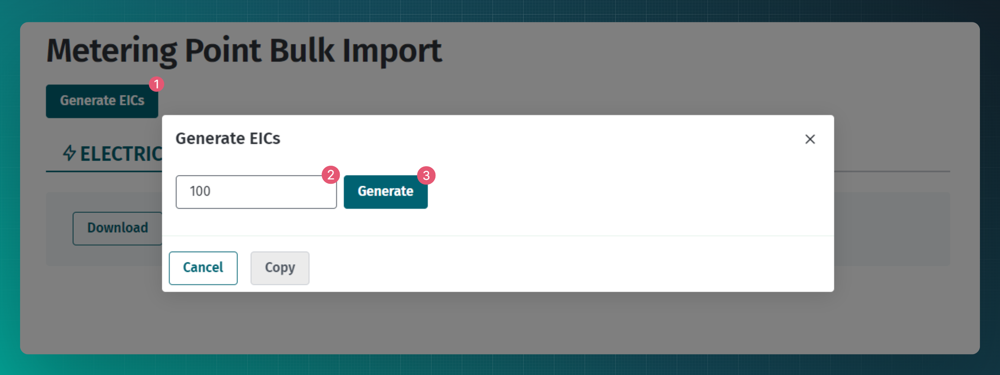
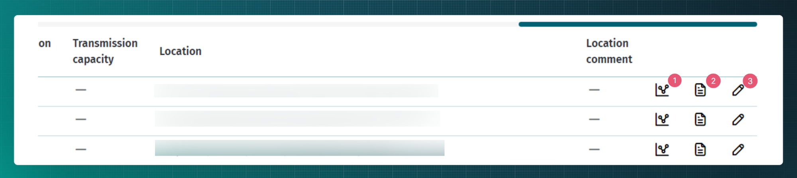

# Mõõtepunktid

## Sisukord

<!-- TOC -->
* [Mõõtepunktid](#mõõtepunktid)
  * [Sisukord](#sisukord)
  * [Sissejuhatus](#sissejuhatus)
  * [Mõõtepunkti andmete edastamine](#mõõtepunkti-andmete-edastamine)
    * [Mõõtepunkti API V3 üldised reeglid](#mõõtepunkti-API-V3-üldised-reeglid)
    * [Mõõtepunktide lisamine veebiliideses](#mõõtepunktide-lisamine-veebiliideses)
    * [Mõõtepunktide masslaadimine](#mõõtepunktide-masslaadimine)
    * [EIC koodide Masinliidese sõnumid](#eic-koodide-masinliidese-sõnumid)
* [Elektri mõõtepunkti API andmekoosseis](#elektri-mõõtepunkti-api-andmekoosseis)
  * [Elektri mõõtepunkti V3 andmete edastamine](#elektri-mõõtepunkti-v3-andmete-edastamine)
    * [Üldandmed](#üldandmed)
    * [Elektri mõõtepunkti metaandmed](#elektri-mõõtepunkti-metaandmed)
    * [Asukohaandmed](#asukohaandmed)
    * [V3 versioonis lisandunud atribuudid](#v3-versioonis-lisandunud-atribuudid)
    * [V3 versioonis muudetud reeglid](#v3-versioonis-muudetud-reeglid)
    * [Elektri API sõnumid](#elektri-api-sõnumid)
    * [Elektri GET V3 otsinguparameetrid](#elektri-get-v3-otsinguparameetrid)
* [Gaasi mõõtepunkti API andmekoosseis](#gaasi-mõõtepunkti-api-andmekoosseis)
  * [Gaasi mõõtepunkti V3 andmete edastamine](#gaasi-mõõtepunkti-v3-andmete-edastamine)
    * [Üldandmed](#üldandmed)
    * [Gaasi mõõtepunkti metaandmed](#gaasi-mõõtepunkti-metaandmed)
    * [Asukohaandmed](#asukohaandmed)
    * [V3 versioonis muudetud reeglid](#v3-versioonis-muudetud-reeglid)
    * [Gaasi API sõnumid](#gaasi-api-sõnumid)
    * [GET V3 otsinguparameetrid](#get-v3-otsinguparameetrid)
* [Agregeerimise mõõtepunkti API andmekoosseis](#agregeerimise-mõõtepunkti-api-andmekoosseis)
  * [Agregeerimise mõõtepunkti V3 andmete edastamine](#agregeerimise-mõõtepunkti-v3-andmete-edastamine)
    * [Üldandmed](#üldandmed-1)
    * [Agregeerimise mõõtepunkti metaandmed](#agregeerimise-mõõtepunkti-metaandmed)
    * [Asukohaandmed](#asukohaandmed-1)
    * [V3 versioonis muudetud reeglid](#v3-versioonis-muudetud-reeglid)
    * [Agregeerimise API sõnumid](#agregeerimise-api-sõnumid)
    * [GET V3 otsinguparameetrid](#get-v3-otsinguparameetrid)
<!-- TOC -->

## Sissejuhatus

> [!WARNING] 
> NB! 2027 aasta 1. kvartalil võtame kasutusele mõõtepunkti API-de V3 versioonid. Alates mõõtepunkti API V3 versioonidest tulevad elektri-, gaasi- ja agregeerimise mõõtepunktidele eraldi API-d. 
> Mõõtepunkti V2 API-d jäävad peale V3 API-de kasutuselevõttu paralleelselt kasutusele kuueks kuuks. 

Mõõtepunkt on seade, mis mõõdab energia tarbimise ja tootmise koguseid teatud asukohas.

Mõõtepunkte haldavad järgmised turuosalised:

- võrguettevõtja;
- liinivaldaja;
- suletud jaotusvõrgu ettevõtja;
- agregaator;
- tootja;
- laadimispunkti operaator;
- salvestusjaama operaator;
- gaasitankla operaator.

Käesolevas dokumendis nimetatakse neid ühisnimetajaga **Mõõtepunkti haldur**.

Mõõtepunkti haldur vastutab Andmelaos tema piirkonnas olevate mõõtepunktid kohta mõõtepunkti andmete lisamise ja uuendamise eest.

> [!WARNING] 
> NB! Mõõtepunkti haldur on kohustatud mõõtepunkti andmeid uuendama esimesel võimalusel.

## Mõõtepunkti andmete edastamine

Mõõtepunkti haldur saab mõõtepunktide tehnilised andmed edastada Estfeed Datahubi:

- ükshaaval veebiliidese või vastava automaatse andmevahetuse liidese kaudu
- masslaadimisega veebiliidese või vastava automaatse andmevahetuse liidese kaudu

Mõõtepunktide andmed on samalaadsed nii andmevahetuse teenustes kui ka veebiliides.

### Mõõtepunkti API V3 üldised reeglid

### Üldised kasutusõigused ja päised

Mõõtepunkti API V3 kasutamisel määratakse päringu kontekst HTTP päistega.

| Päis või õigus | Selgitus |
|---|---|
| `Authorization` | Päring peab sisaldama kehtivat JWT-tokenit. |
| `x-market-participant-eic` | Turuosalise EIC kood, kelle nimel päring tehakse. |
| `x-market-participant-role` | Tururoll, milles päring tehakse. |
| `x-commodity-type` | Energiakandja liik. Elektri ja agregeerimise API korral `ELECTRICITY`, gaasi API korral `NATURAL_GAS`. |
| `EDIT_METERING_POINT` | Nõutud mõõtepunkti loomisel ja muutmisel. |
| `VIEW_METERING_POINT` | Nõutud mõõtepunktide otsimisel. |

JWT-tokenis olev õigus peab olema seotud sama turuosalise EIC, tururolli ja energiakandja kombinatsiooniga, mis on esitatud päringu päistes.

### Mõõtepunkti loomise üldised reeglid

- Mõõtepunkti EIC kood peab olema valiidne ja kuuluma päringu tegijale eraldatud EIC-vahemikku.
- Sama EIC koodiga mõõtepunkt ei tohi Estfeed Datahubis juba eksisteerida.
- Mõõtepunkti omanik määratakse päringu päistes esitatud `x-market-participant-eic` ja `x-market-participant-role` alusel.
- Mõõtepunkti energiakandja peab vastama kasutatud API-le ja `x-commodity-type` päisele.
- Mõõtepunkti metaandmete objekt peab vastama kasutatud API liigile. Elektri API-s kasutatakse elektri, gaasi API-s gaasi ja agregeerimise API-s agregeerimise metaandmestikku.
- Mõõtepunkti loomisel määratakse uue kirje kehtivuse alguseks loomise kuupäev ja kellaaeg.

### Mõõtepunkti muutmise üldised reeglid

- Muudetava mõõtepunkti EIC edastatakse PUT-päringu path-parameetrina.
- Mõõtepunkt peab Estfeed Datahubis eksisteerima.
- Mõõtepunkt peab kuuluma päringu päistes esitatud turuosalisele ja tururollile.
- Mõõtepunkti EIC koodi, omanikku, energiakandjat ega mõõtepunkti tüüpi ei saa PUT-päringuga muuta.
- PUT-päring ei kirjuta olemasolevat mõõtepunkti versiooni üle. Andmeladu loob mõõtepunktist uue versiooni.
- Uus versioon märgitakse kehtivaks versiooniks ning selle kehtivuse alguseks määratakse muutmise kuupäev ja kellaaeg.
- Eelmise versiooni kehtivus lõpetatakse muutmise kuupäeva ja kellaajaga.
- Metaandmetest ja asukohaandmetest luuakse uued versioonid. Varasemaid kirjeid ei kirjutata üle.

### Mõõtepunkti tüübi ja tururolli üldised reeglid

| Mõõtepunkt | Lubatud tururollid mõõtepunkti loomiseks |
|---|---|
| Elektri `REGULAR` või `INTERNAL` mõõtepunkt | `GRID_OPERATOR`, `LINE_OPERATOR`, `CLOSED_DISTRIBUTION_NETWORK`, `PRODUCER_OPERATOR`, `CHARGING_POINT_OPERATOR`, `ENERGY_STORAGE_UNIT` |
| Gaasi `REGULAR` mõõtepunkt | `GRID_OPERATOR`, `PRODUCER_OPERATOR`, `STORAGE_OPERATOR`, `GAS_STATION_OPERATOR` |
| Elektri või gaasi `BORDER` mõõtepunkt | `GRID_OPERATOR`|
| `AGGREGATION` mõõtepunkt | `AGGREGATOR`|

### Aadressiandmete üldised reeglid

- `county` peab vastama aktiivsele EHAK taseme 1 üksusele.
- `municipality` peab vastama aktiivsele EHAK taseme 2 üksusele ja kuuluma määratud maakonda.
- `locality` on kohustuslik, kui määratud omavalitsusel on EHAK taseme 3 üksus.
- Kui `locality` esitatakse, peab see kuuluma määratud omavalitsusse.
- `streetAddress` sisaldab tänava, maja, korteri või muude ADS tasemete 4–8 andmeid.
- Kui õige sihtnumber ei ole teada, kasutatakse väärtust `00000`.
- Tekstiliste aadressiandmete esitamisel tuleb kasutada EHAK klassifikaatori ametlikke nimekujusid.

### Koordinaatide üldised reeglid

- `coordinates` objekt ei ole kohustuslik.
- Kui `coordinates` objekt on esitatud, on `latitude`, `longitude` ja `coordinateSystem` kohustuslikud.
- `coordinateSystem` lubatud väärtused on `WGS84` ja `LEST97`.
- LEST97 korral peab `latitude` sisaldama seitset kohta enne koma ja 1–3 kohta pärast koma.
- LEST97 korral peab `longitude` sisaldama kuut kohta enne koma ja 1–3 kohta pärast koma.
- WGS84 korral peab `latitude` ja `longitude` sisaldama kahte kohta enne koma ja 4–8 kohta pärast koma.
- Koordinaadid peavad olema arvulised väärtused.

### GET V3 üldised otsingureeglid

- Mitme otsinguparameetri kasutamisel ühendatakse tingimused loogilise `AND`-iga.
- `viewMode` vaikimisi väärtus on `FULL`.
- `hasCustomerAuthorization` vaikimisi väärtus on `false`.
- Kui `hasCustomerAuthorization=true`, otsitakse ainult mõõtepunkte, millele päringu tegijal on Kliendiportaali kaudu antud kehtiv volitus.
- Kui `hasCustomerAuthorization=false`, Kliendiportaali volitust otsingu alusena ei kasutata ning rakendatakse mõõtepunkti omandi, tururolli ja lepingutega seotud ligipääsureegleid.
- `location.location` võimaldab otsida mõõtepunkti kombineeritud aadressitekstist.
- `location.comment` võimaldab teha osalist tekstiotsingut asukoha kommentaarist.
- `page` väärtus algab nullist.
- `size` maksimaalne väärtus on 500.

### GET V3 üldised ligipääsureeglid

Täielikud mõõtepunkti andmed tagastatakse juhul, kui vähemalt üks järgnevatest tingimustest on täidetud:

- päringu tegija on mõõtepunkti omanik;
- päringu tegijal on Kliendiportaali kaudu antud kehtiv ligipääsuõigus;
- päringu tegijal on mõõtepunktiga seotud kehtiv või ligipääsureeglitega lubatud varasem leping;
- päringu tegijal on vastava mõõtepunktiga seotud tulevikus jõustuv leping ning täidetud on API ja energiakandja spetsiifilised tingimused;
- päringu tegijal on ülemmõõtepunkti omanikuna õigus alammõõtepunkti andmetele;
- päringu tegijal on agregaatorina ligipääs agregeerimislepingu või talle kuuluva agregeerimise mõõtepunkti kaudu.

Kui ükski ligipääsu alus ei kehti, mõõtepunkti täielikke andmeid ei tagastata. Kliendipõhise lepingu loomise teenuse korral võidakse täielike andmete asemel tagastada ainult mõõtepunkti EIC kood.

### V3 vastuse üldine andmekoosseis

V3 teenuse vastus võib sisaldada järgmisi andmeid:

| Atribuut | Selgitus |
|---|---|
| `eic` | Mõõtepunkti EIC kood. |
| `commodityType` | Mõõtepunkti energiakandja liik. |
| `meteringPointType` | Mõõtepunkti tüüp. |
| `meteringType` | Mõõtmise viis. |
| `owner` | Mõõtepunkti omaniku andmed, sealhulgas EIC ja tururoll. |
| `customer` | Kehtiva lepinguga seotud klient, kui kliendi andmete tagastamine on ligipääsureeglite alusel lubatud. |
| `characteristics` | Energiakandja või agregeerimise spetsiifilised metaandmed. |
| `location` | Mõõtepunkti asukohaandmed. |

POST- ja PUT-teenus tagastab eduka töötlemise korral loodud või muudetud mõõtepunkti andmed. Vea korral tagastatakse standardne veavastus.

### Pagineeritud GET-vastus

GET-otsingu vastus on lehekülgedeks jaotatud vastus. Vastus sisaldab vähemalt järgmisi pagineerimise andmeid:

| Atribuut | Selgitus |
|---|---|
| `content` | Leitud mõõtepunktide loend. |
| `page` | Tagastatud lehekülje number. |
| `size` | Lehekülje suurus. |
| `totalElements` | Otsingutingimustele vastavate kirjete koguarv. |
| `totalPages` | Otsingutulemuse lehekülgede koguarv. |

### Mõõtepunktide lisamine veebiliideses

Veebiliidese kaudu on elektri-, gaasi-, agregeerimsie mõõtepunkide ükshaaval lisamine, masslaadimine ja pärimine sarnase loogikaga. Alljärgnevad kasutajaliidese piltidega näited on elektri mõõtepunkti näitel. 

Vajadusel on võimalik järgmine vaba mõõtepunkti EIC kood genereerida veebiliidese kaudu navigeerides "Metering points" -> "Metering Point Bulk Import" lehele. Täpsustada tuleb soovitud EIC koodide arv.

Mõõtepunkti lisamiseks veebiliideses on 2 võimalust:

- ükshaaval;
- masslaadimisega.

Ükshaaval laadimiseks tuleks navigeerida "Metering points" lehele.

1. Alustuseks tuleks vajutada nupule "New".
2. Seejärel on vaja avanevas modaalaknas täita kõik kohustuslikud väljad (märgitud tärniga).
3. Kui "Create" nupp on mitteaktiivne on tõenäoliselt jäänud mõni kohustuslik väli täitmata.

Mõõtepunktide masslaadimine on võimalik MS Excel faili abil navigeerides "Metering points" -> "Metering Point Bulk Import" lehele.

1. Vajutades lehel "Download" nupule on võimalik allalaadida template.
2. "Import" nupp avab modaalakna.
3. Seejärel on võimalik lisada mõõtepunki(de) andmetega täidetud fail.

Mõõtepunktide otsimiseks tuleks navigeerida "Metering points" lehele.

1. Soovi korral on võimalik lisada 1 või rohkem otsingukriteeriumit.
2. Ilma ühtegi välja täitmata ja kohe "Search" nuppu vajutades väljastatakse kõigi mõõtepunktide andmed.
Ühe või rohkema otsingukriteeriumi lisamisel väljastatakse vaid nendele kriteeriumitele vastavad mõõtepunktid.
3. Võimalik on otsingut täpsustada täiendavate kriteeriumitega, need valikud avanevad vajutades "Detailed search" nupule.

Peale mõõtepunkti otsingu tulemuste saamist on võimalik:
1. vaadata mõõtepunkti mõõteandmeid;
2. vaadata mõõtepunktiga seotud lepinguid;
3. muuta mõõtepunkti andmeid.

Kirjeldatud on mõõtepunkte haldavate turuosaliste õigused, teistel rollidel mõõtepunkti muutmise õigus puudub.

### Mõõtepunktide masslaadimine

Nii veebiliideses kui ka andmevahetuse liideses on loodud võimalus mõõtepunkide masslaadimiseks MS Excel faili abil. Selleks tuleb veebiliidese või teenuse `template` kaudu laadida alla energikandja liigi spetsiifiline templiit, lisada andmed ning täidetud templiit uuesti veebi või teenuse `import` vahendusel üles laadida.

Mõõtepunkti andmekoosseis on kirjeldatud koos API-dega alljärgnevates peatükkides:
- Elekter: [Elektri mõõtepunkti API andmekoosseis](#elektri-mõõtepunkti-api-andmekoosseis)
- Gaas: [Gaasi mõõtepunkti API andmekoosseis](#gaasi-mõõtepunkti-api-andmekoosseis)
- Agregeerimine: [Agregeerimise mõõtepunkti API andmekoosseis](#agregeerimise-mõõtepunkti-api-andmekoosseis)

### EIC koodide Masinliidese sõnumid

#### Sõnumid

| Sõnum                      | Eesmärk                                             |
|-------------------------------|-----------------------------------------------------|
| `POST /api/v1/eic/amount`                            | **Enda** EIC vahemikust vabade EIC koodide otsing   |
| `POST /api/v1/eic/range`                        | Turusalise **enda** EIC koodi vahemike otsing       |

# Elektri mõõtepunkti API andmekoosseis

## Elektri mõõtepunkti V3 andmete edastamine

### Üldandmed

| Atribuut teenuses | V2 | V3 | Kommentaar |
|-------------------|----|----|------------|
| eic | jah | jah | Mõõtepunkti EIC kood |
| meteringPointType | jah | jah | Mõõtepunkti tüüp |
| meteringType | jah | jah | Mõõtmise viis |
| characteristics | jah | jah | Elektri mõõtepunkti metaandmed |
| location | jah | jah | Mõõtepunkti asukohaandmed |

### Elektri mõõtepunkti metaandmed

| Atribuut teenuses | Kohustuslik V2 versioonis? | Kohustuslik V3 versioonis? | Muud reeglid |
|-------------------|---------------------------|---------------------------|-------------|
| consumptionScale | jah | jah | SMALL, LARGE |
| connectionState | jah | jah | CONNECTED, DISCONNECTED |
| resolution | jah | jah | V2: PT15M (15 minutit), PT1H (1 tund), V3: 15_MINUTES  |
| customerType | jah | jah | Üks neist:  CONSUMER (tarbija), GRID_OPERATOR (võrguettevõtja), PRODUCER (tootja), MICRO (mikrotootja), LINE_OPERATOR (liinivaldaja), ENERGY_STORAGE_UNIT (salvestusjaam), CHARGING_POINT_OPERATOR (laadimispunkti operaator) |
| production | jah | jah | TRUE/FALSE |
| apartmentAssociation | jah | jah | TRUE/FALSE |

### Elektri mõõtepunkti spetsiifilised metaandmed

| Atribuut teenuses | Tulba nimetus masslaadimise templiidis | Selgitus | Kohustuslik V2 versioonis? | Kohustuslik V3 versioonis? | Muud reeglid |
|-------------------|----------------------------------------|----------|----------------------------|----------------------------|--------------|
| productionSource  | Production Source | energia tootmise allikas | jah, kui production=true | jah, kui production=true | Üks neist: SOLAR (päike), WIND (tuul), HYDRO (vesi), BIOGAS (biogaas), BIOMASS (biomass), NATURAL_GAS (gaas), OIL_SHALE (põlevkivi), OTHER_RENEWABLE (muu taastuv), OTHER_NON_RENEWABLE (muu mittetaastuv). |
| transmissionNetworkEic | Transmission Network EIC | ülekandevõrgu 16 kohaline EIC kood | jah | ei | Määratud ülekandevõrgu EIC kood peab eksisteerima süsteemis. Energiakandja tüüp peab ühtima mõõtepunkti omaga. Koodi puudumisel võib kasutada koodi 38A-1234567890-1. V3 versioonis ei ole kohustuslik |
| isolatedMeteringPoint | Isolated Metering Point | kas tegemist on isoleeritud mõõtepunktiga | jah | jah | Üks neist: TRUE (jah), FALSE (ei) |
| electricalHeating | Electrical Heating | kas mõõtepunktis toimub elektriga kütmist | jah | jah | Üks neist: TRUE (jah), FALSE (ei) |
| chargingPoint | Charging Point | kas mõõtepunktis toimub elektri laadimist | jah | jah | Üks neist: TRUE (jah), FALSE (ei) |
| storageCapacity | Storage Capacity | energiasalvestusvõimsus (kW) | jah | jah | Peab olema täis- või komakohaga (max. 2 komakohta) number. |
| storageEnergy | Storage Energy | energiasalvesti mahtuvus (kWh) | jah | jah | Peab olema täis- või komakohaga (max. 2 komakohta) number. |
| productionCapacity | Production Capacity | tootmise maht (kW) | jah | jah | Peab olema täis- või komakohaga (max. 2 komakohta) number. |
| transmissionCapacity | Transmission Capacity | ülekande maht (kW) | jah | jah | Peab olema täis- või komakohaga (max. 2 komakohta) number. |
| esuScheme | ESU Scheme | energiasalvesti skeem | atribuut puudub | ei | Üks neist: STANDALONE (eraldiseisev salvesti), PRODUCTION (salvesti + tootmine), CONSUMPTION (salvesti + tarbimine), HYBRID (Salvesti + tootmine + tarbimine) |
| esuSchemeValidFrom | ESU Scheme Valid From | energiasalvesti skeemi kehtivuse algus | atribuut puudub | ei | Energiasalvesti skeemi algus päeva täpsusega |
| esuQuantitiesProvider | ESU Quantities Provider | energiasalvesti mõõteandmete esitaja | atribuut puudub | ei | Üks neist: OWNER (omanik), CUSTOMER (mõõtepunkti klient) |
| esuBilling | ESU Billing | energiasalvesti arveldusskeemi kasutamine | atribuut puudub | ei | Üks neist: TRUE (jah), FALSE (ei). |
| esuBillingValidFrom | ESU Billing Valid From | energiasalvesti arveldusskeemi kehtivuse algus | atribuut puudub | ei | Energiasalvesti arvelsusskeemi algus päeva täpsusega |
| bidirectional | Bidirectional | kas mõõtepunkt on kahesuunaline | atribuut puudub | ei | Üks neist: TRUE (jah), FALSE (ei). |
| bidirectionalChangeTime | Bidirectional Change Time | kahesuunalisuse muudatuse aeg | atribuut puudub | ei | Kellaaeg peab olema 15-minutilise täpsusega, minutite väärtus peab olema: 00, 15, 30 või 45. Sekundite väärtus peab alati olema 00. |

### Asukohaandmed

| Atribuut teenuses | Kohustuslik V2 versioonis? | Kohustuslik V3 versioonis? | Kommentaar |
|-------------------|---------------------------|---------------------------|------------|
| adrId | ei | ei | ADS aadressi identifikaator |
| comment | ei | ei | Kommentaar |
| county | jah | jah | Maakond, peab ühtima EHAK level 1 |
| municipality | jah | jah | Omavalitsus, peab ühtima EHAK level 2-ga ja sisalduma level 1-s |
| locality | ei | tingimuslik | V3-s kohustuslik kui EHAK tase 3 on olemas. Peab sisalduma level 3-s ja sisalduma EHAK level 2-s |
| streetAddress | jah | jah | Tänav, maja, korter (ADS levels 4-8) |
| postcode | jah | jah | Sihtnumber |
| coordinates | ei | ei | Koordinaadid |

#### Koordinaadid

| Atribuut teenuses | Kohustuslik V2 versioonis? | Kohustuslik V3 versioonis? | Kommentaar |
|-------------------|---------------------------|---------------------------|------------|
| latitude | jah, kui coordinates on täidetud | jah, kui coordinates on täidetud | Laiuskraad |
| longitude | jah, kui coordinates on täidetud | jah, kui coordinates on täidetud | Pikkuskraad |
| coordinateSystem | jah, kui coordinates on täidetud | jah, kui coordinates on täidetud | WGS84 või LEST97 |

### V3 versioonis lisandunud atribuudid

| Atribuut | Kirjeldus |
|-----------|-----------|
| esuScheme | Energiasalvesti skeem |
| esuSchemeValidFrom | Energiasalvesti skeemi jõustumise kuupäev |
| esuQuantitiesProvider | Energiasalvesti koguste esitaja |
| esuBilling | Energiasalvesti arveldusloogika |
| esuBillingValidFrom | Energiasalvesti arvelduse jõustumise kuupäev |
| bidirectional | Kahesuunaline mõõtepunkt |
| bidirectionalChangeTime | Kahesuunalisuse muudatuse aeg |

### V3 versioonis muudetud reeglid

| Atribuut | Muudatus |
|-----------|----------|
| transmissionNetworkEic | Kohustuslik → vabatahtlik |
| resolution | Kasutab ainult 15_MINUTES enumit |
| API struktuur | Üldine mõõtepunkti API jagati elektri-, gaasi- ja agregeerimise API-deks |

### Elektri API sõnumid 

| Sõnum | Eesmärk |
|---|---|
| `POST /api/v3/metering-points/electricity` | Elektri mõõtepunkti lisamine. |
| `PUT /api/v3/metering-points/electricity/` | Elektri mõõtepunkti muutmine. |
| `GET /api/v3/metering-points/electricity` | Elektri mõõtepunktide otsimine. EIC edastatakse vajaduse korral query-parameetrina. |
| `GET /api/v3/customers/{customerEic}/metering-points/electricity` | Kliendi elektri mõõtepunktide otsimine uue lepingu loomise protsessis. |

### Elektri API kasutamise reeglid

- `x-commodity-type` peab olema `ELECTRICITY`.
- Elektri API lubab elektri mõõtepunkti andmekoosseisu.
- Mõõtepunkti tüüp peab vastama elektri API-s lubatud mõõtepunkti tüübile.
- Agregeerimise mõõtepunkte ei looda ega muudeta elektri mõõtepunkti API kaudu, vaid eraldi agregeerimise API kaudu.
- Elektri GET-teenus ei tagasta agregeerimise mõõtepunkte.
- `resolution` V3 väärtus on `15_MINUTES`.
- `transmissionNetworkEic` ei ole V3-s kohustuslik.
- Kui `production=true`, on `productionSource` kohustuslik.

### Elektri GET V3 otsinguparameetrid

`GET /api/v3/metering-points/electricity` võimaldab kasutada järgmisi otsinguparameetreid:

| Parameeter | Kohustuslik | Reegel |
|---|---|---|
| `eic` | ei | Mõõtepunkti EIC kood. Mõõtepunkt peab Andmelaos eksisteerima. |
| `meteringPointType` | ei | Lubatud alamhulk: `REGULAR`, `BORDER`, `INTERNAL`. |
| `meteringType` | ei | Mõõtmise viis. |
| `customerEic` | ei | Klient peab Andmelaos eksisteerima. Tagastatakse mõõtepunktid, kus kliendil on aktiivne `GRID` leping. |
| `viewMode` | ei | Vaikimisi väärtus on `FULL`. |
| `hasCustomerAuthorization` | ei | Vaikimisi `false`. Väärtuse `true` korral tagastatakse ainult kliendi antud kehtiva volitusega mõõtepunktid. |
| `consumptionScale` | ei | Tarbimismaht. |
| `connectionState` | ei | Ühenduse olek. |
| `resolution` | ei | Elektri V3 väärtus on `15_MINUTES`. |
| `customerType` | ei | Elektri mõõtepunkti kliendi tüüp. |
| `production` | ei | Näitab, kas mõõtepunktis toimub tootmine. |
| `productionSource` | ei | Tootmisallikas. |
| `transmissionNetworkEic` | ei | Ülekandevõrgu EIC peab Andmelaos eksisteerima ja selle energiakandja peab vastama mõõtepunkti energiakandjale. |
| `apartmentAssociation` | ei | Näitab, kas mõõtepunkt on seotud korteriühistuga. |
| `isolatedMeteringPoint` | ei | Näitab, kas tegemist on isoleeritud mõõtepunktiga. |
| `electricalHeating` | ei | Näitab, kas mõõtepunktis kasutatakse elektrikütet. |
| `chargingPoint` | ei | Näitab, kas tegemist on laadimispunktiga. |
| `bidirectional` | ei | Näitab, kas mõõtepunkt on kahesuunaline. |
| `location.adrId` | ei | ADS-aadressi identifikaator. |
| `location.location` | ei | Osaline otsing ADS-i tasemete 1–8 kombineeritud aadressist. |
| `location.comment` | ei | Osaline otsing asukoha kommentaarist. |
| `page` | ei | Lehekülje number. Nummerdamine algab nullist. |
| `size` | ei | Lehekülje suurus. Maksimaalne väärtus on 500. |

#### Elektri GET V3 ligipääsureeglid

Kui `hasCustomerAuthorization=true`, tagastatakse ainult mõõtepunktid,
millele päringu tegijal on Kliendiportaalis antud kehtiv volitus.

Kui `hasCustomerAuthorization=false`, rakendatakse tururollipõhiseid reegleid:

- `GRID_OPERATOR`, `LINE_OPERATOR`, `CLOSED_DISTRIBUTION_NETWORK`,
  `PRODUCER_OPERATOR`, `CHARGING_POINT_OPERATOR` ja
  `ENERGY_STORAGE_UNIT` näevad mõõtepunkte, mille omanikuks nad on;
- `AGGREGATOR` ligipääs sõltub mõõtepunktiga seotud aktiivsest
  agregeerimislepingust;
- `OPEN_SUPPLIER` ligipääs sõltub mõõtepunktiga seotud avatud tarne lepingutest
  ja teistest kehtivatest ligipääsureeglitest.

Kui `customerEic` on esitatud, tagastatakse mõõtepunktid, kus kliendil
on päringu tegemise hetkel aktiivne `GRID` leping.

Teenus tagastab ainult elektri mõõtepunkte. `AGGREGATION` tüüpi
mõõtepunkte selle teenusega ei tagastata.

#### Elektri kliendipõhine otsing

`GET /api/v3/customers/{customerEic}/metering-points/electricity` on eriteenus, mida kasutatakse uue lepingu loomise protsessis.

- Teenust kasutab `OPEN_SUPPLIER` või `AGGREGATOR` roll.
- Kasutajal peab olema `VIEW_METERING_POINT` õigus.
- `x-commodity-type` peab olema `ELECTRICITY`.
- Teenus otsib kliendi elektri mõõtepunkte kliendi EIC alusel.
- Otsitakse kliendi mõõtepunkte, kus kliendil on aktiivne või tulevikus jõustuv GRID või BORDER_GRID leping;
- täielikud andmed tagastatakse, kui avatud tarnijal on praegu või viimase 12 kuu jooksul olnud SUPPLY või GENERAL_SERVICE leping või kehtiv kliendi volitus, muul juhul tagastatakse ainult EIC;
- Täielikud andmed tagastatakse juhul, kui päringu tegijal on mõõtepunktile tavapäraste ligipääsureeglite alusel õigus.
- Kui täielik ligipääs puudub, võib teenus lepingu loomise kontrolliks tagastada ainult mõõtepunkti EIC koodi.
- V3 teenuses tagastatakse ainult `GRID_OPERATOR` või `CLOSED_DISTRIBUTION_NETWORK` omandis mõõtepunktid.

#### Versioonide info

V3 versiooni lisandumisel toimusid järgmised muudatused:
  - V3 versioonis lisandusid elektri mõõtepunktile 7 uut atribuuti: `esuScheme`, `esuSchemeValidFrom`, `esuQuantitiesProvider`, `esuBilling`, `esuBillingValidFrom`, `bidirectional`, `bidirectionalChangeTime`. 
  - V3 versioonis muutusid asukoha ja elektri mõõtepunkti spetsiifiliste atribuutide kohustuslikkuse reeglid
  
# Gaasi mõõtepunkti API andmekoosseis

## Gaasi mõõtepunkti V3 andmete edastamine

### Üldandmed

| Atribuut teenuses | V2 | V3 | Kommentaar |
|-------------------|----|----|------------|
| eic | jah | jah | Mõõtepunkti EIC kood. PUT V3 päringus edastatakse EIC path-parameetrina. |
| meteringPointType | jah | jah | Mõõtepunkti tüüp. Lubatud väärtused: REGULAR ja BORDER. |
| meteringType | jah | jah | Mõõtmise viis. |
| characteristics | jah | jah | Gaasi mõõtepunkti metaandmed. |
| location | jah | jah | Mõõtepunkti asukohaandmed. |

### Gaasi mõõtepunkti metaandmed

| Atribuut teenuses | Kohustuslik V2 versioonis? | Kohustuslik V3 versioonis? | Muud reeglid |
|-------------------|----------------------------|----------------------------|--------------|
| consumptionScale | jah | jah | SMALL, LARGE |
| connectionState | jah | jah | CONNECTED, DISCONNECTED |
| resolution | jah | jah | V2: PT1H (1 tund), PT1D (1 päev). V3: HOUR, DAY. |
| customerType | jah | jah | Üks neist: CONSUMER, CONSUMER_2, GRID_OPERATOR, PRODUCER, PROTECTED, PROTECTED_OTHER, GENERAL_INTEREST_SERVICE_PROVIDER, POWER_PRODUCER_FROM_GAS. |
| production | jah | jah | TRUE/FALSE |
| apartmentAssociation | jah | jah | TRUE/FALSE |

V3 API kasutab gaasi mõõtepunktidele eraldi `NaturalGasMeteringPointResolution` enumit. Väärtused teisendatakse Andmelaos järgmiselt:
- `HOUR` ↔ `PT1H`;
- `DAY` ↔ `PT1D`.

### Asukohaandmed

| Atribuut teenuses | Kohustuslik V2 versioonis? | Kohustuslik V3 versioonis? | Kommentaar |
|-------------------|----------------------------|----------------------------|------------|
| adrId | ei | ei | ADS aadressi identifikaator. |
| comment | ei | ei | Kommentaar. |
| county | jah | jah | Maakond, peab ühtima aktiivse EHAK taseme 1 üksusega. |
| municipality | jah | jah | Omavalitsus, peab ühtima aktiivse EHAK taseme 2 üksusega ja kuuluma määratud maakonda. |
| locality | ei | tingimuslik | V3-s kohustuslik, kui määratud omavalitsusel on EHAK taseme 3 üksus. Väärtus peab kuuluma määratud omavalitsusse. |
| streetAddress | jah | jah | Tänav, maja, korter või muud ADS tasemed 4-8. |
| postcode | jah | jah | Sihtnumber. Kui õige sihtnumber ei ole teada, kasutatakse väärtust 00000. |
| coordinates | ei | ei | Koordinaadid. |

#### Koordinaadid

| Atribuut teenuses | Kohustuslik V2 versioonis? | Kohustuslik V3 versioonis? | Kommentaar |
|-------------------|----------------------------|----------------------------|------------|
| latitude | jah, kui coordinates on täidetud | jah, kui coordinates on täidetud | Laiuskraad. |
| longitude | jah, kui coordinates on täidetud | jah, kui coordinates on täidetud | Pikkuskraad. |
| coordinateSystem | jah, kui coordinates on täidetud | jah, kui coordinates on täidetud | WGS84 või LEST97. |

### V3 versioonis muudetud reeglid

| Atribuut | Muudatus |
|----------|----------|
| API struktuur | Üldine mõõtepunkti API jagati elektri-, gaasi- ja agregeerimise API-deks. |
| sourceType | Atribuut eemaldati. Ligipääs määratakse tururolli, mõõtepunkti omandi, lepingute ja kliendi antud volituste alusel. |
| resolution | V3 kasutab gaasi mõõtepunkti spetsiifilist enumit väärtustega HOUR ja DAY. |
| locality | V3-s kohustuslik, kui määratud omavalitsusel on EHAK taseme 3 üksus. |
| Asukohaandmete valideerimine | county, municipality ja locality valideeritakse aktiivse EHAK klassifikaatori vastu. |

### Gaasi API sõnumid

| Sõnum | Eesmärk |
|---|---|
| `POST /api/v3/metering-points/natural-gas` | Gaasi mõõtepunkti lisamine. |
| `PUT /api/v3/metering-points/natural-gas/` | Gaasi mõõtepunkti muutmine. |
| `GET /api/v3/metering-points/natural-gas` | Gaasi mõõtepunktide otsimine. |
| `GET /api/v3/customers/{customerEic}/metering-points/natural-gas` | Kliendi gaasi mõõtepunktide otsimine uue lepingu loomise protsessis. |

### Gaasi API kasutamise reeglid

- `x-commodity-type` peab olema `NATURAL_GAS`.
- `AGGREGATOR` roll ei saa gaasi mõõtepunkti luua ega muuta.
- `BORDER` tüüpi gaasi mõõtepunkti saab luua ainult `GRID_OPERATOR`.
- `REGULAR` tüüpi gaasi mõõtepunkti saavad luua `GRID_OPERATOR`, `PRODUCER_OPERATOR`, `STORAGE_OPERATOR` ja `GAS_STATION_OPERATOR`.
- Gaasi GET-teenus tagastab ainult `NATURAL_GAS` mõõtepunkte.
- Gaasi GET-teenus ei tagasta `AGGREGATION` tüüpi mõõtepunkte.
- Gaasi V3 resolutsiooni lubatud väärtused on `HOUR` ja `DAY`.
- Andmelaos vastab `HOUR` väärtusele `PT1H` ja `DAY` väärtusele `PT1D`.

#### GET V3 otsinguparameetrid

`GET /api/v3/metering-points/natural-gas` võimaldab kasutada järgmisi otsinguparameetreid:

| Parameeter | Kohustuslik | Reegel |
|---|---|---|
| `eic` | ei | Mõõtepunkti EIC kood. Mõõtepunkt peab Andmelaos eksisteerima. |
| `meteringPointType` | ei | Mõõtepunkti tüüp. Lubatud väärtused on `REGULAR` ja `BORDER`. |
| `meteringType` | ei | Mõõtmise viis. |
| `customerEic` | ei | Kliendi EIC kood. Klient peab Andmelaos eksisteerima. Tagastatakse mõõtepunktid, kus kliendil on päringu tegemise hetkel aktiivne `GRID` leping. |
| `viewMode` | ei | Vastuse kuvamisviis. Vaikimisi väärtus on `FULL`. |
| `hasCustomerAuthorization` | ei | Vaikimisi väärtus on `false`. Väärtuse `true` korral tagastatakse ainult mõõtepunktid, millele päringu tegijal on Kliendiportaali kaudu antud kehtiv volitus. |
| `consumptionScale` | ei | Tarbimismaht. Lubatud väärtused on `SMALL` ja `LARGE`. |
| `connectionState` | ei | Ühenduse olek. Lubatud väärtused on `CONNECTED` ja `DISCONNECTED`. |
| `resolution` | ei | Mõõteandmete resolutsioon. Lubatud väärtused on `HOUR` ja `DAY`. |
| `customerType` | ei | Gaasi mõõtepunkti kliendi tüüp. |
| `production` | ei | Näitab, kas mõõtepunktis toimub gaasi tootmine. |
| `apartmentAssociation` | ei | Näitab, kas mõõtepunkt on seotud korteriühistuga. |
| `location.adrId` | ei | Maa- ja Ruumiameti ADS-aadressi identifikaator. |
| `location.location` | ei | Võimaldab teha osalist otsingut ADS-i tasemete 1–8 põhjal moodustatud kombineeritud aadressist. |
| `location.comment` | ei | Võimaldab teha osalist tekstiotsingut asukoha kommentaarist. |
| `page` | jah | Lehekülje number. Lehekülgede nummerdamine algab nullist. Järgmise lehekülje küsimiseks kasutatakse väärtust `n+1`. |
| `size` | jah | Lehekülje suurus. Maksimaalne väärtus on 500. |

Mitme otsinguparameetri kasutamisel ühendatakse tingimused loogilise `AND`-iga.

### Gaasi GET V3 ligipääsureeglid

Kui `hasCustomerAuthorization=true`, tagastatakse ainult mõõtepunktid, millele päringu tegijal on Kliendiportaali kaudu antud kehtiv volitus.

Kui `hasCustomerAuthorization=false`, rakendatakse vähemalt järgmisi põhimõtteid:

- `GRID_OPERATOR`, `PRODUCER_OPERATOR`, `STORAGE_OPERATOR` ja `GAS_STATION_OPERATOR` näevad neile kuuluvaid gaasi mõõtepunkte;
- `OPEN_SUPPLIER` ligipääs sõltub mõõtepunktiga seotud tarnelepingutest ja muudest mõõtepunkti ligipääsureeglitest;
- agregaatorile ei tagastata gaasi mõõtepunkte tavapärase agregeerimise ligipääsuloogika alusel;
- täielike andmete tagastamine sõltub mõõtepunkti omandist, kehtivast volitusest või lepingulisest ligipääsust.

#### Gaasi kliendipõhine otsing

`GET /api/v3/customers/{customerEic}/metering-points/natural-gas` on eriteenus, mida kasutatakse uue lepingu loomise protsessis.

- Teenust kasutab `OPEN_SUPPLIER` roll.
- Kasutajal peab olema `VIEW_METERING_POINT` õigus.
- `x-commodity-type` peab olema `NATURAL_GAS`.
- Teenus otsib kliendi gaasi mõõtepunkte kliendi EIC alusel.
- Täielikud andmed tagastatakse juhul, kui päringu tegijal on mõõtepunktile tavapäraste ligipääsureeglite alusel õigus.
- Kui täielik ligipääs puudub, võib teenus lepingu loomise kontrolliks tagastada ainult mõõtepunkti EIC koodi.
- V3 teenuses tagastatakse ainult `GRID_OPERATOR` või `CLOSED_DISTRIBUTION_NETWORK` omandis mõõtepunktid.

#### Versioonide info

V3 versiooni lisandumisel toimusid järgmised muudatused:
- üldine mõõtepunkti API jagati elektri-, gaasi- ja agregeerimise API-deks;
- gaasi mõõtepunktidele lisandus eraldi `NaturalGasMeteringPointResolution` enum;
- V3 API-st eemaldati `sourceType` atribuut;
- asukohaandmete EHAK-põhist valideerimist täpsustati.

# Agregeerimise mõõtepunkti API andmekoosseis

Agregeerimise mõõtepunkt on elektri energiakandjaga mõõtepunkt, mille tüüp on alati `AGGREGATION`. API kasutamisel peab `x-commodity-type` olema `ELECTRICITY` ja tururoll `AGGREGATOR`.

Täispikk juhend on agregeerimismõõtepunkti lisamise kohta on saadaval [siin](https://elering.ee/sites/default/files/2026-06/Iseseisva%20agregaatori%20reguleerimisandmete%20esitamise%20juhend%20Estfeed%20Datahubis.pdf).

## Agregeerimise mõõtepunkti V3 andmete edastamine

### Üldandmed

| Atribuut teenuses | V2 | V3 | Kommentaar |
|-------------------|----|----|------------|
| eic | jah | jah | Mõõtepunkti EIC kood. PUT V3 päringus edastatakse EIC path-parameetrina. |
| meteringPointType | jah | API määrab | Väärtus on alati AGGREGATION ja seda ei edastata POST või PUT päringu kehas. |
| meteringType | jah | jah | Mõõtmise viis. |
| characteristics | jah | jah | Agregeerimise mõõtepunkti metaandmed. |
| location | jah | jah | Mõõtepunkti asukohaandmed. |

POST-päringus peab `eic` kuuluma agregaatorile eraldatud EIC-vahemikku ning sama EIC koodiga mõõtepunkt ei tohi juba süsteemis eksisteerida.  
PUT-päringus peab URL-is esitatud mõõtepunkt eksisteerima, kuuluma päringu tegijale, olema energiakandja tüübiga `ELECTRICITY` ja mõõtepunkti tüübiga `AGGREGATION`.

### Agregeerimise mõõtepunkti metaandmed

| Atribuut teenuses | Kohustuslik V2 versioonis? | Kohustuslik V3 POST-is? | V3 PUT reegel | Muud reeglid |
|-------------------|----------------------------|-------------------------|---------------|--------------|
| parentMeteringPointEic | jah | jah | Ei ole PUT päringu kehas ja seda ei saa muuta. | Peab viitama süsteemis registreeritud REGULAR mõõtepunktile, mille omanik on GRID_OPERATOR või CLOSED_DISTRIBUTION_NETWORK. Ülemmõõtepunkt peab olema sama energiakandja tüübiga. |
| aggregationProductType | jah | jah | Väärtust saab lisada ainult juhul, kui eelnev väärtus puudub. | Üks neist: MFRR, AFRR, FCR, D1, D, LOCAL_PRODUCT. |
| assetType | jah | jah | Väärtust saab lisada ainult juhul, kui eelnev väärtus puudub. | CONSUMPTION või PRODUCTION. |
| aggregationProductionType | jah, kui assetType=PRODUCTION | jah, kui assetType=PRODUCTION | Väärtust saab lisada ainult juhul, kui eelnev väärtus puudub. | Lubatud ainult juhul, kui assetType=PRODUCTION. Üks neist: BESS, BV, WIND, HYDRO, OTHER. |
| resourceEic | jah | jah | Väärtust saab lisada ainult juhul, kui eelnev väärtus puudub. | Ressursi EIC kood peab vastama EIC vormingule ja kuuluma agregaatorile. |

### Asukohaandmed

| Atribuut teenuses | Kohustuslik V2 versioonis? | Kohustuslik V3 versioonis? | Kommentaar |
|-------------------|----------------------------|----------------------------|------------|
| adrId | ei | ei | ADS aadressi identifikaator. |
| comment | ei | ei | Kommentaar. |
| county | jah | jah | Maakond, peab ühtima aktiivse EHAK taseme 1 üksusega. |
| municipality | jah | jah | Omavalitsus, peab ühtima aktiivse EHAK taseme 2 üksusega ja kuuluma määratud maakonda. |
| locality | ei | tingimuslik | V3-s kohustuslik, kui määratud omavalitsusel on EHAK taseme 3 üksus. |
| streetAddress | jah | jah | Tänav, maja, korter või muud ADS tasemed 4-8. |
| postcode | jah | jah | Sihtnumber. Kui õige sihtnumber ei ole teada, kasutatakse väärtust 00000. |
| coordinates | ei | ei | Koordinaadid. |

#### Koordinaadid

| Atribuut teenuses | Kohustuslik V2 versioonis? | Kohustuslik V3 versioonis? | Kommentaar |
|-------------------|----------------------------|----------------------------|------------|
| latitude | jah, kui coordinates on täidetud | jah, kui coordinates on täidetud | Laiuskraad. |
| longitude | jah, kui coordinates on täidetud | jah, kui coordinates on täidetud | Pikkuskraad. |
| coordinateSystem | jah, kui coordinates on täidetud | jah, kui coordinates on täidetud | WGS84 või LEST97. |

### V3 versioonis muudetud reeglid

| Atribuut | Muudatus |
|----------|----------|
| API struktuur | Agregeerimise mõõtepunktidele loodi eraldi API. |
| sourceType | Atribuut eemaldati. Ligipääs määratakse tururolli, mõõtepunkti omandi, lepingute ja kliendi antud volituste alusel. |
| meteringPointType | API määrab väärtuseks alati AGGREGATION. |
| parentMeteringPointEic | Esitatakse POST päringus, kuid puudub PUT päringu kehast ja seda ei saa tavapärase PUT päringuga muuta. |
| Metaandmete muutmine | aggregationProductType, assetType, aggregationProductionType ja resourceEic väärtusi saab lisada ainult juhul, kui eelnev väärtus puudub. |
| locality | V3-s kohustuslik, kui määratud omavalitsusel on EHAK taseme 3 üksus. |

### Agregeerimise API sõnumid

| Sõnum | Eesmärk |
|---|---|
| `POST /api/v3/metering-points/aggregation` | Agregeerimise mõõtepunkti lisamine. |
| `PUT /api/v3/metering-points/aggregation` | Agregeerimise mõõtepunkti muutmine. |
| `GET /api/v3/metering-points/aggregation` | Agregeerimise mõõtepunktide otsimine. |

### Agregeerimise API kasutamise reeglid

- `x-commodity-type` peab olema `ELECTRICITY`.
- `x-market-participant-role` peab POST- ja PUT-päringu korral olema `AGGREGATOR`.
- Mõõtepunkti tüübiks määrab süsteem alati `AGGREGATION`.
- `meteringPointType` ei edastata POST- ega PUT-päringu kehas.
- Agregeerimise mõõtepunkti omanik määratakse päringu päistes esitatud agregaatori EIC ja tururolli alusel.
- Agregeerimise GET-teenus tagastab ainult `AGGREGATION` tüüpi mõõtepunkte.

### Ülemmõõtepunkti reeglid

- `parentMeteringPointEic` on POST-päringus kohustuslik.
- Ülemmõõtepunkt peab Andmelaos eksisteerima.
- Ülemmõõtepunkt peab olema tüübiga `REGULAR`.
- Ülemmõõtepunkt peab olema sama energiakandja tüübiga.
- Ülemmõõtepunkti omanik peab olema `GRID_OPERATOR` või `CLOSED_DISTRIBUTION_NETWORK`.
- `parentMeteringPointEic` ei ole PUT-päringu kehas ja seda ei saa PUT-päringuga muuta.

### Agregeerimise metaandmete muutmise reeglid

| Atribuut | PUT V3 reegel |
|---|---|
| `aggregationProductType` | Väärtuse võib lisada juhul, kui eelnev väärtus puudub. Olemasolevat väärtust teise väärtusega asendada ei saa. |
| `assetType` | Väärtuse võib lisada juhul, kui eelnev väärtus puudub. Olemasolevat väärtust teise väärtusega asendada ei saa. |
| `aggregationProductionType` | Väärtuse võib lisada juhul, kui eelnev väärtus puudub ja `assetType=PRODUCTION`. |
| `resourceEic` | Väärtuse võib lisada juhul, kui eelnev väärtus puudub. |

Kui `assetType=PRODUCTION`, on `aggregationProductionType` kohustuslik. Kui `assetType` ei ole `PRODUCTION`, ei tohi `aggregationProductionType` olla esitatud.

`resourceEic` peab vastama ressursi EIC vormingule. Ärireegli järgi peab ressurss kuuluma agregaatorile, kuid kuuluvuse automaatne kontroll võib V3 esimeses lahenduses puududa.

### Agregeerimise GET V3 ligipääsureeglid

Kui `hasCustomerAuthorization=true`, tagastatakse ainult agregeerimise mõõtepunktid, millele päringu tegijal on Kliendiportaali kaudu antud kehtiv volitus.

Kui `hasCustomerAuthorization=false`, rakendatakse vähemalt järgmisi reegleid:

- `AGGREGATOR` näeb talle kuuluvaid agregeerimise mõõtepunkte;
- `GRID_OPERATOR` ja `CLOSED_DISTRIBUTION_NETWORK` näevad agregeerimise mõõtepunkte, mille ülemmõõtepunkt neile kuulub;
- `OPEN_SUPPLIER` ligipääs sõltub mõõtepunktiga seotud lepingutest ja muudest mõõtepunkti ligipääsureeglitest;
- teistele tururollidele agregeerimise mõõtepunkte ei tagastata.

Kui `customerEic` on esitatud, tagastatakse mõõtepunktid, kus kliendil on päringu tegemise hetkel aktiivne `AGGREGATION` leping.

### GET V3 otsinguparameetrid

`GET /api/v3/metering-points/aggregation` võimaldab kasutada järgmisi otsinguparameetreid:

| Parameeter | Kohustuslik | Reegel |
|---|---|---|
| `eic` | ei | Agregeerimise mõõtepunkti EIC kood. Mõõtepunkt peab Andmelaos eksisteerima. |
| `meteringType` | ei | Mõõtmise viis. |
| `customerEic` | ei | Kliendi EIC kood. Klient peab Andmelaos eksisteerima. Tagastatakse mõõtepunktid, kus kliendil on päringu tegemise hetkel aktiivne `AGGREGATION` leping. |
| `viewMode` | ei | Vastuse kuvamisviis. Vaikimisi väärtus on `FULL`. |
| `parentMeteringPointEic` | ei | Ülemmõõtepunkti EIC kood. Ülemmõõtepunkt peab Andmelaos eksisteerima, olema tüübiga `REGULAR` ja sama energiakandjaga. |
| `hasCustomerAuthorization` | ei | Vaikimisi väärtus on `false`. Väärtuse `true` korral tagastatakse ainult mõõtepunktid, millele päringu tegijal on Kliendiportaali kaudu antud kehtiv volitus. |
| `aggregationProductType` | ei | Agregeerimise toote tüüp. Lubatud väärtused määrab `AggregationProductType` enum. |
| `assetType` | ei | Vara tüüp. Lubatud väärtused on `CONSUMPTION` ja `PRODUCTION`. |
| `aggregationProductionType` | ei | Tootmise tüüp. Kasutatakse juhul, kui `assetType=PRODUCTION`. Lubatud väärtused määrab `AggregationProductionType` enum. |
| `resourceEic` | ei | Ressursi EIC kood. Peab vastama ressursi EIC vormingule. |
| `location.adrId` | ei | Maa- ja Ruumiameti ADS-aadressi identifikaator. |
| `location.location` | ei | Võimaldab teha osalist otsingut ADS-i tasemete 1–8 põhjal moodustatud kombineeritud aadressist. |
| `location.comment` | ei | Võimaldab teha osalist tekstiotsingut asukoha kommentaarist. |
| `page` | jah | Lehekülje number. Lehekülgede nummerdamine algab nullist. Järgmise lehekülje küsimiseks kasutatakse väärtust `n+1`. |
| `size` | jah | Lehekülje suurus. Maksimaalne väärtus on 500. |

Mitme otsinguparameetri kasutamisel ühendatakse tingimused loogilise `AND`-iga. Agregeerimise GET-teenus tagastab ainult `AGGREGATION` tüüpi mõõtepunkte.

> [!NOTE]
> Agregeerimise mõõtepunktidele ei ole eraldi kliendipõhist GET-teenust. Kliendi järgi otsimiseks kasutatakse `customerEic` otsinguparameetrit.

### Versioonide info

V3 versiooni lisandumisel toimusid järgmised muudatused:
- agregeerimise mõõtepunktidele loodi eraldi API;
- V3 API-st eemaldati `sourceType` atribuut;
- mõõtepunkti tüüp määratakse API poolt väärtuseks `AGGREGATION`;
- täpsustati agregeerimise metaandmete muutmise piiranguid;
- asukohaandmete EHAK-põhist valideerimist täpsustati.
