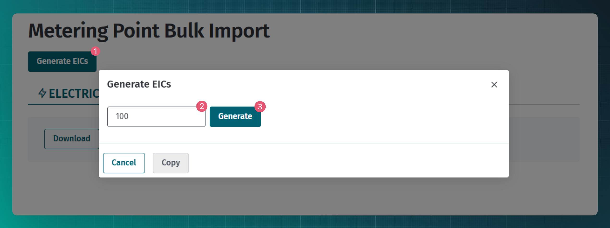
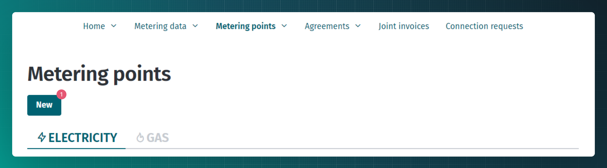
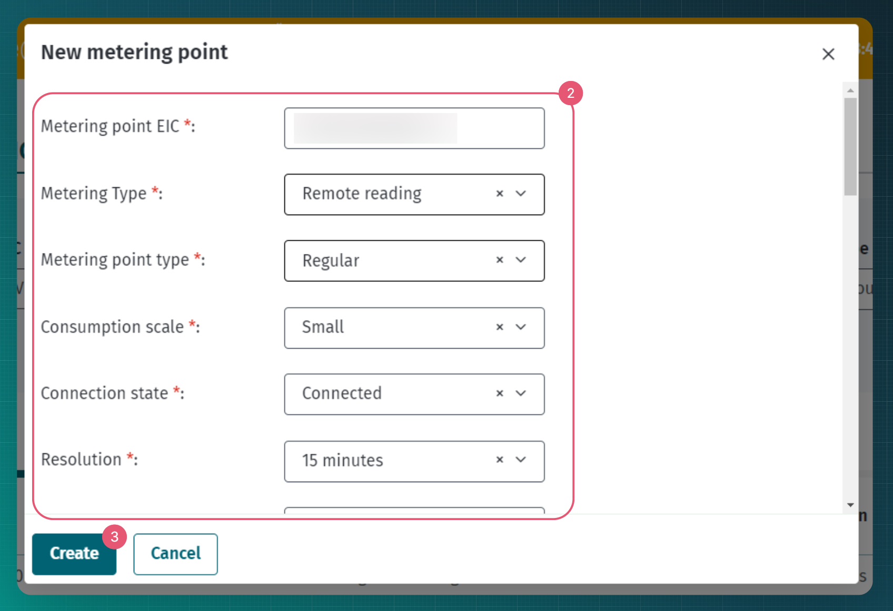
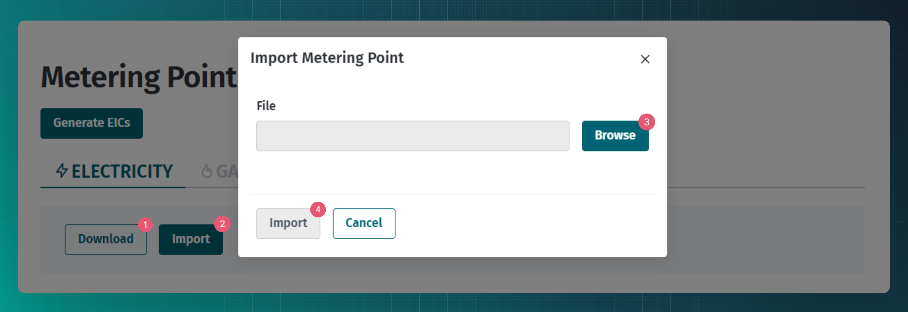
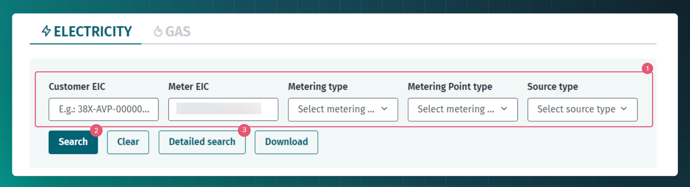
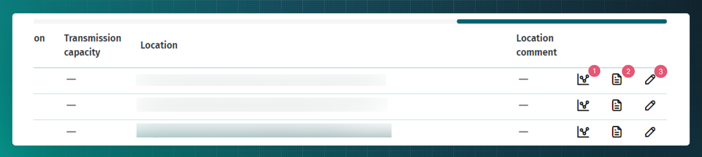

# Mõõtepunktid

## Sisukord

<!-- TOC -->
* [Mõõtepunktid](#mõõtepunktid)
  * [Sisukord](#sisukord)
  * [Sissejuhatus](#sissejuhatus)
  * [Mõõtepunkti andmete edastamine](#mõõtepunkti-andmete-edastamine)
    * [Veebiliides](#veebiliides)
    * [Mõõtepunktide masslaadimine](#mõõtepunktide-masslaadimine)
    * [Masinliidese sõnumid](#masinliidese-sõnumid)
      * [Sõnumid](#sõnumid)
        * [Versioonide info](#versioonide-info)
      * [Sõnumite reeglid](#sõnumite-reeglid)
  * [Mõõtepunkti andmete küsimine](#mõõtepunkti-andmete-küsimine)
    * [Masinliidese sõnumid](#masinliidese-sõnumid-1)
      * [Sõnumid](#sõnumid-1)
        * [Versioonide info](#versioonide-info-1)
      * [Sõnumite reeglid](#sõnumite-reeglid-1)
        * [`meter/search` ja `meter/export` reeglid](#metersearch-ja-meterexport-reeglid)
        * [`meter/search/customer` reeglid](#metersearchcustomer-reeglid)
<!-- TOC -->

## Sissejuhatus

Mõõtepunkt on seade, mis mõõdab energia tarbimise ja tootmise koguseid teatud asukohas.

Mõõtepunkte haldavad järgmised turuosalised:

- võrguettevõtja;
- liinivaldaja;
- suletud jaotusvõrgu ettevõtja;
- agregaator;
- tootja;
- laadimispunkti operaator;
- salvestusjaama operaator;
- gaasitankla operaator.

Käesolevas dokumendis nimetatakse neid ühisnimetajaga **Mõõtepunkti haldur**.

Mõõtepunkti haldur vastutab Andmelaos tema piirkonnas olevate mõõtepunktid kohta mõõtepunkti andmete lisamise ja uuendamise eest.

> [!WARNING] 
> NB! Mõõtepunkti haldur on kohustatud mõõtepunkti andmeid uuendama esimesel võimalusel.

## Mõõtepunkti andmete edastamine

Mõõtepunkti haldur saab mõõtepunktide tehnilised andmed edastada Andmelattu:

- ükshaaval veebiliidese või vastava automaatse andmevahetuse liidese kaudu
- masslaadimisega veebiliidese või vastava automaatse andmevahetuse liidese kaudu

Mõõtepunktide andmed on samalaadsed nii andmevahetuse teenustes kui ka veebiliides. Mõõtepunkti andmed on:

- Ühised andmed kõikidele mõõtepunktidele:

| Atribuut teenuses | Tulba nimetus masslaadimise templiidis | Selgitus                         | Kohustuslik? | Muud reeglid                                                                                        |
|-------------------|----------------------------------------|----------------------------------|--------------|-----------------------------------------------------------------------------------------------------|
| meterEic          | Metering Point EIC                     | mõõtepunkti 16 kohaline EIC kood | jah          | Peab olema valiidne EIC kood ja mahtuma eraldatud EIC koodi vahemikku                               |
| meteringType      | Metering Type                          | mõõtmise viis                    | jah          | Üks neist: REMOTE_READING (kaugloetav), VIRTUAL (virtuaalne), NON_REMOTE_READING (mitte kaugloetav) |
| meteringPointType | Metering Point Type                    | mõõtepunkti tüüp                 | jah          | Üks neist: REGULAR (tavaline), INTERNAL (sisemine)(ainult elekter), BORDER(piiri), AGGREGATION (agregeerimise) (ainult elekter)      |

- Elektri ja gaasi mõõtepunktide ühised metaandmed:

| Atribuut teenuses      | Tulba nimetus masslaadimise templiidis | Selgitus                                 | Kohustuslik?             | Muud reeglid                                                                                                                                                                                                                  |
|------------------------|----------------------------------------|------------------------------------------|--------------------------|-------------------------------------------------------------------------------------------------------------------------------------------------------------------------------------------------------------------------------|
| consumptionScale       | Consumption Scale                      | tarbimise maht mõõtepunktis              | jah                      | Üks neist: SMALL (väiketarbija), LARGE (suurtarbija)                                                                                                                                                                          |
| connectionState        | Conection State                        | ühenduse olek mõõtepunktis               | jah                      | Üks neist: CONNECTED (ühendatud), DISCONNECTED (katkestatud)                                                                                                                                                                  |
| resolution             | Resolution                             | mõõtepunkti resolutsioon                 | jah                      | Üks neist: PT15M (15 minutit), PT1H (1 tund)                                                                                                                                                                                  |
| customerType           | Customer Type                          | tarbimise tüüp mõõtepunktis              | jah                      | Üks neist: Elekter:  CONSUMER (tarbija), GRID_OPERATOR (võrguettevõtja), PRODUCER (tootja), MICRO (mikrotootja), LINE_OPERATOR (liinivaldaja), ENERGY_STORAGE_UNIT (salvestusjaam), CHARGING_POINT_OPERATOR (laadimispunkti operaator). Gaas: CONSUMER - mittekaitstud tarbija (gaasivarustuse katkestuse aeg >6h) CONSUMER_2 - mittekaitstud tarbija (gaasivarustuse katkestuse aeg < 6h), GRID_OPERATOR, PRODUCER, PROTECTED - kaitstud kodutarbija, PROTECTED_OTHER - muu kaitstud tarbija, GENERAL_INTEREST_SERVICE_PROVIDER - Üldhuviteenuse osutajast tarbija, POWER_PRODUCER_FROM_GAS Elektrisüsteemile oluline gaasist elektrit tootev tarbija   |
| production             | Production                             | kas mõõtepunktis toimub energia tootmist | jah                      | Üks neist: TRUE (jah), FALSE (ei)                                                |
| apartmentAssociation   | Apartment Association                  | kas tegu on korteriühistuga              | jah                      | Üks neist: TRUE (jah), FALSE (ei)                                                                                                                                                                                             |

- Elektri mõõtepunkti spetsiifilised metaandmed:

| Atribuut teenuses     | Tulba nimetus masslaadimise templiidis | Selgitus                                  | Kohustuslik V1 versioonis? | Kohustuslik V2 versioonis? | Muud reeglid                                                                            |
|-----------------------|----------------------------------------|-------------------------------------------|----------------------------|----------------------------|-----------------------------------------------------------------------------------------|
| productionSource  | Production Source  | energia tootmise allikas | jah, kui production=true | jah, kui production=true | Üks neist: SOLAR (päike), WIND (tuul), HYDRO (vesi), BIOGAS (biogaas), BIOMASS (biomass), NATURAL_GAS (gaas), OIL_SHALE (põlevkivi), OTHER_RENEWABLE (muu taastuv), OTHER_NON_RENEWABLE (muu mittetaastuv). |
|  transmissionNetworkEic | Transmission Network EIC | ülekandevõrgu 16 kohaline EIC kood | jah | jah | Määratud ülekandevõrgu EIC kood peab eksisteerima süsteemis. Energiakandja tüüp peab ühtima mõõtepunkti omaga. Koodi puudumisel võib kasutada koodi 38A-1234567890-1. |
| isolatedMeteringPoint | Isolated Metering Point                | kas tegemist on isoleeritud mõõtepunktiga | jah                        | jah                        | Üks neist: TRUE (jah), FALSE (ei)                                                       |
| electricalHeating     | Electrical Heating                     | kas mõõtepunktis toimub elektriga kütmist | jah                        | jah                        | Üks neist: TRUE (jah), FALSE (ei)                                                       |
| chargingPoint         | Charging Point                         | kas mõõtepunktis toimub elektri laadimist | jah                        | jah                        | Üks neist: TRUE (jah), FALSE (ei)                                                       |
| storageCapacity       | Storage Capacity                       | energiasalvestusvõimsus (kW)              | ei                         | jah                        | Peab olema täis- või komakohaga (max. 2 komakohta)number. |
| storageEnergy         | Storage Energy                         | energiasalvesti mahtuvus (kWh)            | ei                         | jah                        | Peab olema täis- või komakohaga (max. 2 komakohta)number. |
| productionCapacity    | Production Capacity                    | tootmise maht (kW)                        | ei                         | jah                        | Peab olema täis- või komakohaga (max. 2 komakohta)number. |
| transmissionCapacity  | Transmission Capacity                  | ülekande maht (kW)                        | ei                         | jah                        | Peab olema täis- või komakohaga (max. 2 komakohta)number. |

- Agregeerimise mõõtepunkti spetsiifilised metaandmed:

| Atribuut teenuses         | Tulba nimetus masslaadimise templiidis | Selgitus                             | Kohustuslik V1 versioonis? | Kohustuslik V2 versioonis?       | Muud reeglid                                                                                                                              |
|---------------------------|----------------------------------------|--------------------------------------|----------------------------|----------------------------------|-------------------------------------------------------------------------------------------------------------------------------------------|
| parentMeterEic            | Parent Metering Point EIC              | ülemmõõtepunkti 16 kohaline EIC kood | jah                        | jah                              | Peab viitama Andmelaos registreeritud tava mõõtepunktile, mille omaniku tururoll peab olema GRID_OPERATOR või CLOSED_DISTRIBUTION_NETWORK. Väärtuse muutmine ei ole lubatud.                                              |
| aggregationProductType    | Agregation product type                | Agregeerimise toote tüüp             | atribuut puudub            | jah                              | Üks neist: MFRR, AFRR, FCR, D1, D, LOCAL_PRODUCT. Väärtuse uuendamine on lubatud ainult siis, kui eelnev väärtus puudub.                  |
| assetType                 | Asset type                             | Mõõtepunkti vara tüüp                | atribuut puudub            | jah                              | Üks neist: CONSUMPTION, PRODUCTION. Väärtuse uuendamine on lubatud ainult siis, kui eelnev väärtus puudub.                                |
| aggregationProductionType | Aggregation production type            | Mõõtepunkti tootmise tüüp            | atribuut puudub            | jah, kui vara tüüp on PRODUCTION | Üks neist: BESS, BV, WIND, HYDRO, OTHER. Väärtuse uuendamine on lubatud ainult siis, kui eelnev väärtus puudub ja vara tüüp on PRODUCTION |
| resourceEic               | Resource EIC                           | Ressursi EIC                         | atribuut puudub            | jah                              | Ei pea viitama Andmelaos registreeritud EIC koodile. Väärtuse uuendamine on lubatud ainult siis, kui eelnev väärtus puudub.               |

Täispikk juhend on agregeerimismõõtepunkti lisamise kohta on saadaval [siin](https://elering.ee/sites/default/files/2026-06/Iseseisva%20agregaatori%20reguleerimisandmete%20esitamise%20juhend%20Estfeed%20Datahubis.pdf).

- Ühised aadressi andmed kõikidele mõõtepunktidele:

| Atribuut teenuses | Tulba nimetus masslaadimise templiidis | Selgitus                                              | Kohustuslik V1 versioonis?              | Kohustuslik V2 versioonis?     | Muud reeglid                                                                                                                                    |
|-------------------|----------------------------------------|-------------------------------------------------------|-----------------------------------------|:-------------------------------|-------------------------------------------------------------------------------------------------------------------------------------------------|
| adrId             | Adr ID                                 | Maaameti ADS süsteemi aadressi ID (ADR_ID)            | jah kui county ja municipality on puudu | ei                             | Peab olema täisarv                                                                                                                              |
| comment           | Comment                                | kommentaar                                            | ei                                      | ei                             |                                                                                                                                                 |
| county            | County                                 | maakond (ADS tase 1)                                  | jah                                     | jah                            |                                                                                                                                                 |
| municipality      | Municipality                           | vald, linn(ADS tase 2)                                | jah                                     | jah                            |                                                                                                                                                 |
| locality          | Locality                               | asustusüksus(ADS tase 3)                              | ei                                      | ei                             |                                                                                                                                                 |
| streetAddress     | Street Address                         | kohaadress (tänav, maja, korter jne, ADS tasemed 4-8) | jah                                     | jah                            |                                                                                                                                                 |
| postcode          | Postcode                               | sihtnumber                                            | jah                                     | jah                            | Õige sihtnumbri puudumisel tuleks kasutada sihtnumbrina 00000.                                                                                  |
| latitude          | Latitude                               | koordinaadi laiuskraad                                | ei                                      | ei                             | LEST97 puhul peab väärtus olema olema 7 kohta enne ja 1-3 kohta peale koma. WGS84 puhul peab väärtus olema 2 kohta enne ja 4-8 kohta peale koma |
| longitude         | Longitude                              | koordinaadi pikkuskraad                               | ei                                      | ei                             | LEST97 puhul peab väärtus olema olema 6 kohta enne ja 1-3 kohta peale koma. WGS84 puhul peab väärtus olema 2 kohta enne ja 4-8 kohta peale koma |
| coordinateSystem  | Coordinate Sytem                       | koordinaatsüsteem                                     | jah, kui koordinaadid on antud          | jah, kui koordinaadid on antud | Üks neist: WGS84, LEST97                                                                                                                        |

> [!NOTE]
> Aadressi andmete struktuur ja validatsioonid on täiendamisel

### Veebiliides

Vajadusel on võimalik järgmine vaba mõõtepunkti EIC kood genereerida veebiliidese kaudu navigeerides "Metering points" -> "Metering Point Bulk Import" lehele. Täpsustada tuleb soovitud EIC koodide arv.

Mõõtepunkti lisamiseks veebiliideses on 2 võimalust:

- ükshaaval;
- masslaadimisega.

Ükshaaval laadimiseks tuleks navigeerida "Metering points" lehele.

1. Alustuseks tuleks vajutada nupule "New".
2. Seejärel on vaja avanevas modaalaknas täita kõik kohustuslikud väljad (märgitud tärniga).
3. Kui "Create" nupp on mitteaktiivne on tõenäoliselt jäänud mõni kohustuslik väli täitmata.

Mõõtepunktide masslaadimine on võimalik MS Excel faili abil navigeerides "Metering points" -> "Metering Point Bulk Import" lehele.

1. Vajutades lehel "Download" nupule on võimalik allalaadida template.
2. "Import" nupp avab modaalakna.
3. Seejärel on võimalik lisada mõõtepunki(de) andmetega täidetud fail.

Mõõtepunktide otsimiseks tuleks navigeerida "Metering points" lehele.

1. Soovi korral on võimalik lisada 1 või rohkem otsingukriteeriumit.
2. Ilma ühtegi välja täitmata ja kohe "Search" nuppu vajutades väljastatakse kõigi mõõtepunktide andmed.
Ühe või rohkema otsingukriteeriumi lisamisel väljastatakse vaid nendele kriteeriumitele vastavad mõõtepunktid.
3. Võimalik on otsingut täpsustada täiendavate kriteeriumitega, need valikud avanevad vajutades "Detailed search" nupule.

Peale mõõtepunkti otsingu tulemuste saamist on võimalik:
1. vaadata mõõtepunkti mõõteandmeid;
2. vaadata mõõtepunktiga seotud lepinguid;
3. muuta mõõtepunkti andmeid.

Kirjeldatud on mõõtepunkte haldavate turuosaliste õigused, teistel rollidel mõõtepunkti muutmise õigus puudub.

### Mõõtepunktide masslaadimine

Nii veebiliideses kui ka andmevahetuse liideses on loodud võimalus mõõtepunkide masslaadimiseks MS Excel faili abil. Selleks tuleb veebiliidese või teenuse `template` kaudu laadida alla energikandja liigi spetsiifiline templiit, lisada andmed ning täidetud templiit uuesti veebi või teenuse `import` vahendusel üles laadida.

Mõõtepunkti andmed on kirjeldatud peatükis [Mõõtepunkti andmete edastamine](#mõõtepunkti-andmete-edastamine), kuid esineb üks erisus - kuivõrd andmete templiit on juba energiakandja tüübi spetsiifiline, siis mõõtepunkti tüüpi tuleb täpsustada ainult elektri või gaasi mõõtepunkti puhul (REGULAR või INTERNAL).

### Masinliidese sõnumid

#### Sõnumid

 | Sõnum                      | Eesmärk                                             |
|-------------------------------|-----------------------------------------------------|
| `POST /api/v2/meter`          | Mõõtepunkti lisamine                                |
|`PUT /api/v2/meter`           | Mõõtepunkti muutmine                                |
| `POST /api/v1/eic/amount`                            | **Enda** EIC vahemikust vabade EIC koodide otsing   |
| `POST /api/v1/eic/range`                        | Turusalise **enda** EIC koodi vahemike otsing       |

##### Versioonide info

V2 versiooni lisandumisel toimusid järgmised muudatused:
  - V2 versioonis lisandusid agregeerimise mõõtepunktile 4 uut atribuuti: `aggregationProductType`, `assetType`, `aggregationProductionType` ja `resourceType`. 
  - V2 versioonis muutusid asukoha ja elektri mõõtepunkti spetsiifiliste atribuutide kohustuslikkuse reeglid 
  - V1 versioonis pole enam võimalik lisada ega muuta agregeerimise mõõtepunkte

#### Sõnumite reeglid

- Mõõtepunkti EIC kood peab jääma võrguettevõtja mõne EIC koodide vahemiku piiresse
- Mõõtepunki sõnumi `marketParticipantContext.commodityType` määrab mõõtepunkti energiakandja liigi ning sellest tulenevalt lubatud metaandmestiku:
  - väärtuse `ELECTRICITY` puhul - lubatud ja nõutud on elektri või agregeerimise metaandmestik;
  - väärtuse `NATURAL_GAS` puhul - lubatud ja nõutud on gaasi või agregeerimise metaandmestik;
- Mõõtepunkti tüüp defineerib lubatud metaandmestiku:
  - regulaarne, piirimõõtepunkt, sisemine - lubatud on gaasi või elektri metaandmestik;
  - agregeerimise - lubatud on agregeerimise metaandmestik;
- Mõõtepunkti resolutsioon on täiendav info ja ei mõjuta mõõteandmete edastamist tulevikus vaid iseloomustab, kas mõõtepunkt suudab  reaalsuses tarbimist mõõta 15 minuti, 1 tunni või päeva täpsusega.
- XY koordinaatide reeglid:
  - XY koordinaadid ei ole nõutud;
  - XY koordinaadid peavad olema numbrid, mis võivad sisaldada komakohtasid;
  - XY koordinaadid peavad jääma Eestit ümbritseva mõttelise ristküliku sisse;
- Elektri tava mõõtepunkti loomiseks peab `marketParticipantRole` väärtus olema üks neist:
  - GRID_OPERATOR
  - LINE_OPERATOR
  - CLOSED_DISTRIBUTION_NETWORK
  - PRODUCER_OPERATOR
  - CHARGING_POINT_OPERATOR
- Gaasi tava mõõtepunkti loomiseks peab `marketParticipantRole` väärtus olema üks neist:
  - GRID_OPERATOR
  - PRODUCER_OPERATOR
- Piiri mõõtepunkti loomiseks peab `marketParticipantRole` väärtus olema üks neist:
  - GRID_OPERATOR
- Agregeerimise mõõtepunkti loomiseks peab `marketParticipantRole` väärtus olema AGGREGATOR
- Aadressi tekstilisel kujul saatmise korral on andmekvaliteedi huvides palve kasutada ametlikke [EHAK klassifikaatoris](https://klassifikaatorid.stat.ee/Item/stat.ee/c4c47742-12d7-4fea-bc8c-5aeca9112e2a/88) toodud maakonna, omavalitsuse ja asutusüksuse nimekujusid.

## Mõõtepunkti andmete küsimine

Üldiselt võivad kõik õigustatud kasutajad pärida mõõtepunktide andmeid kasutades `search` teenuseid, kuid avatud tarnija ja bilansihaldur saavad pärida ka uute ja muutunud mõõtepunktide andmete uuendusi kasutades andmete levitamise teenust.

### Masinliidese sõnumid

#### Sõnumid

| Sõnum                             | Eesmärk                                                                                                                                                                                                         |
|-----------------------------------|-----------------------------------------------------------------------------------------------------------------------------------------------------------------------------------------------------------------|
| `POST /api/v2/meter/search`       | Mõõtepunktide otsing erinevate tunnuste alusel. Vaata järgnevaid peatükke reeglite osas.                                                                                                                        |
| `POST /api/v2/meter/search/customer` | Leida kliendi mõõtepunktid (aktiivsete või tulevikus aktiveeruvate GRID lepingutega) kliendi EIC koodi alusel selleks, **et luua uus SUPPLY leping** (võrgueeskirja §8 lg 5 ette nähtud kontrolli teostamiseks). |
| `POST /api/v1/meter/search/border` | Piirimõõtepunkti otsing                                                                                                                                                                                          |

> [!CAUTION] 
> Teenust `POST /api/{version}/meter/search/customer` on lubatud kasutada ainult uue lepingu loomisel ja selle õiguspärast kasutamist monitooritakse

##### Versioonide info

- V2 versioonis lisandusid agregeerimise mõõtepunktile 4 uut atribuuti: `aggregationProductType`, `assetType`, `aggregationProductionType` ja `resourceType`.

#### Sõnumite reeglid

##### `meter/search` ja `meter/export` reeglid

- Andmeladu väljastab kõik mõõtepunkti andmed juhul kui:
  - andmete pärija on mõõtepunkti omanik
  - andmete pärijal on Kliendiportaali kaudu väljastatud ligipääsuõigus
  - andmete pärija on avatud või nimetatud tarnija, kellel on antud mõõtepunktis viimase 12 kuu jooksul olnud aktiivne, on hetkel aktiivne avatud või nimetatud tarne leping
  - Andmete pärija on avatud tarnija, kellel on antud mõõtepunktis kuni 31 päeva tulevikus jõustuv avatud tarne leping ning kelle kliendil on samas mõõtepunktis ja samal perioodil kehtiv võrguleping. Gaasiturul võib avatud tarne leping jõustuda kuni 3 kuu (92 päeva) jooksul tulevikus.
  - andmete pärija on agregaator, kellel on hetkel aktiivne (või oli viimase 12 kuu jooksul aktiivne) agregeerimise leping mõnes antud mõõtepunkti alammõõtepunktis
  - andmete pärija on ülemmõõtepunkti omanik ja päritakse mõne alammõõtepunkti andmeid
- Ülejäänud juhtudel andmeid ei tagastata

##### `meter/search/customer` reeglid

> [!NOTE]
> Teenust `POST /api/{version}/meter/search/customer` saab kasutada vaid avatud tarnija või agregaatori rollis ja andmete pärijal peab selleks olema administraatori või kliendi mõõtepunktide vaatamise õigus (VIEW_CUSTOMER_METERING_POINT).

- Andmeladu väljastab kõik mõõtepunkti andmed juhul kui:
  - andmete pärijal on Kliendiportaali kaudu väljastatud ligipääsuõigus
  - andmete pärija on avatud või nimetatud tarnija, kellel on hetkel aktiivne (või oli viimase 12 kuu jooksul aktiivne) avatud või nimetatud tarne leping antud mõõtepunktis
  - andmete pärija otsib juriidilise isiku või organisatsiooni mõõtepunkte ja kinnitab, et tal on süsteemiväline kirjalikku taasesitust võimaldavas vormis volitus (`legalConsent` väärtus on `true`)
- Ülejäänud juhtudel tagastatakse ainult mõõtepunkti EIC kood

# Elektri mõõtepunkti API andmekoosseis (V2 vs V3)

Alates mõõtepunkti API V3 versioonidest tulevad elektri, gaasi ja agregeerimise mõõtepunktidele eraldi API-d. 
Järgnevalt API-de kirjeldus on Elektri mõõtepunkti API-de kohta.

## Mõõtepunkti V3 andmete edastamine

### Üldandmed

| Atribuut teenuses | V2 | V3 | Kommentaar |
|-------------------|----|----|------------|
| eic | jah | jah | Mõõtepunkti EIC kood |
| meteringPointType | jah | jah | Mõõtepunkti tüüp |
| meteringType | jah | jah | Mõõtmise viis |
| characteristics | jah | jah | Elektri mõõtepunkti metaandmed |
| location | jah | jah | Mõõtepunkti asukohaandmed |

### mõõtepunkti metaandmed

| Atribuut teenuses | Kohustuslik V2 versioonis? | Kohustuslik V3 versioonis? | Muud reeglid |
|-------------------|---------------------------|---------------------------|-------------|
| consumptionScale | jah | jah | SMALL, LARGE |
| connectionState | jah | jah | CONNECTED, DISCONNECTED |
| resolution | jah | jah | V2: PT15M (15 minutit), PT1H (1 tund), V3: 15_MINUTES  |
| customerType | jah | jah | Üks neist:  CONSUMER (tarbija), GRID_OPERATOR (võrguettevõtja), PRODUCER (tootja), MICRO (mikrotootja), LINE_OPERATOR (liinivaldaja), ENERGY_STORAGE_UNIT (salvestusjaam), CHARGING_POINT_OPERATOR (laadimispunkti operaator) |
| production | jah | jah | TRUE/FALSE |
| apartmentAssociation | jah | jah | TRUE/FALSE |

### Elektri mõõtepunkti spetsiifilised metaandmed

| Atribuut teenuses | Tulba nimetus masslaadimise templiidis | Selgitus | Kohustuslik V2 versioonis? | Kohustuslik V3 versioonis? | Muud reeglid |
|-------------------|----------------------------------------|----------|----------------------------|----------------------------|--------------|
| productionSource  | Production Source | energia tootmise allikas | jah, kui production=true | jah, kui production=true | Üks neist: SOLAR (päike), WIND (tuul), HYDRO (vesi), BIOGAS (biogaas), BIOMASS (biomass), NATURAL_GAS (gaas), OIL_SHALE (põlevkivi), OTHER_RENEWABLE (muu taastuv), OTHER_NON_RENEWABLE (muu mittetaastuv). |
| transmissionNetworkEic | Transmission Network EIC | ülekandevõrgu 16 kohaline EIC kood | jah | ei | Määratud ülekandevõrgu EIC kood peab eksisteerima süsteemis. Energiakandja tüüp peab ühtima mõõtepunkti omaga. Koodi puudumisel võib kasutada koodi 38A-1234567890-1. V3 versioonis ei ole kohustuslik |
| isolatedMeteringPoint | Isolated Metering Point | kas tegemist on isoleeritud mõõtepunktiga | jah | jah | Üks neist: TRUE (jah), FALSE (ei) |
| electricalHeating | Electrical Heating | kas mõõtepunktis toimub elektriga kütmist | jah | jah | Üks neist: TRUE (jah), FALSE (ei) |
| chargingPoint | Charging Point | kas mõõtepunktis toimub elektri laadimist | jah | jah | Üks neist: TRUE (jah), FALSE (ei) |
| storageCapacity | Storage Capacity | energiasalvestusvõimsus (kW) | jah | jah | Peab olema täis- või komakohaga (max. 2 komakohta) number. |
| storageEnergy | Storage Energy | energiasalvesti mahtuvus (kWh) | jah | jah | Peab olema täis- või komakohaga (max. 2 komakohta) number. |
| productionCapacity | Production Capacity | tootmise maht (kW) | jah | jah | Peab olema täis- või komakohaga (max. 2 komakohta) number. |
| transmissionCapacity | Transmission Capacity | ülekande maht (kW) | jah | jah | Peab olema täis- või komakohaga (max. 2 komakohta) number. |
| esuScheme | ESU Scheme | energiasalvesti skeem | atribuut puudub | ei | Üks neist: STANDALONE (eraldiseisev salvesti), PRODUCTION (salvesti + tootmine), CONSUMPTION (salvesti + tarbimine), HYBRID (Salvesti + tootmine + tarbimine) |
| esuSchemeValidFrom | ESU Scheme Valid From | energiasalvesti skeemi kehtivuse algus | atribuut puudub | ei | Energiasalvesti skeemi algus päeva täpsusega |
| esuQuantitiesProvider | ESU Quantities Provider | energiasalvesti mõõteandmete esitaja | atribuut puudub | ei | Üks neist: OWNER (omanik), CUSTOMER (mõõtepunkti klient) |
| esuBilling | ESU Billing | energiasalvesti arveldusskeemi kasutamine | atribuut puudub | ei | Üks neist: TRUE (jah), FALSE (ei). |
| esuBillingValidFrom | ESU Billing Valid From | energiasalvesti arveldusskeemi kehtivuse algus | atribuut puudub | ei | Energiasalvesti arvelsusskeemi algus päeva täpsusega |
| bidirectional | Bidirectional | kas mõõtepunkt on kahesuunaline | atribuut puudub | ei | Üks neist: TRUE (jah), FALSE (ei). |
| bidirectionalChangeTime | Bidirectional Change Time | kahesuunalisuse muudatuse aeg | atribuut puudub | ei | Kellaaeg peab olema 15-minutilise täpsusega, minutite väärtus peab olema: 00, 15, 30 või 45. Sekundite väärtus peab alati olema 00. |

### Asukohaandmed

| Atribuut teenuses | Kohustuslik V2 versioonis? | Kohustuslik V3 versioonis? | Kommentaar |
|-------------------|---------------------------|---------------------------|------------|
| adrId | ei | ei | ADS aadressi identifikaator |
| comment | ei | ei | Kommentaar |
| county | jah | jah | Maakond, peab ühtima EHAK level 1 |
| municipality | jah | jah | Omavalitsus, peab ühtima EHAK level 2-ga ja sisalduma level 1-s |
| locality | ei | tingimuslik | V3-s kohustuslik kui EHAK tase 3 on olemas. Peab sisalduma level 3-s ja sisalduma EHAK level 2-s |
| streetAddress | jah | jah | Tänav, maja, korter (ADS levels 4-8) |
| postcode | jah | jah | Sihtnumber |
| coordinates | ei | ei | Koordinaadid |

#### Koordinaadid

| Atribuut teenuses | Kohustuslik V2 versioonis? | Kohustuslik V3 versioonis? | Kommentaar |
|-------------------|---------------------------|---------------------------|------------|
| latitude | jah, kui coordinates on täidetud | jah, kui coordinates on täidetud | Laiuskraad |
| longitude | jah, kui coordinates on täidetud | jah, kui coordinates on täidetud | Pikkuskraad |
| coordinateSystem | jah, kui coordinates on täidetud | jah, kui coordinates on täidetud | WGS84 või LEST97 |

### V3 versioonis lisandunud atribuudid

| Atribuut | Kirjeldus |
|-----------|-----------|
| esuScheme | Energiasalvesti skeem |
| esuSchemeValidFrom | Energiasalvesti skeemi jõustumise kuupäev |
| esuQuantitiesProvider | Energiasalvesti koguste esitaja |
| esuBilling | Energiasalvesti arveldusloogika |
| esuBillingValidFrom | Energiasalvesti arvelduse jõustumise kuupäev |
| bidirectional | Kahesuunaline mõõtepunkt |
| bidirectionalChangeTime | Kahesuunalisuse muudatuse aeg |

### V3 versioonis muudetud reeglid

| Atribuut | Muudatus |
|-----------|----------|
| transmissionNetworkEic | Kohustuslik → vabatahtlik |
| resolution | Kasutab ainult 15_MINUTES enumit |
| API struktuur | Üldine mõõtepunkti API jagati elektri-, gaasi- ja agregeerimise API-deks |

### Masinliidese sõnumid V3 

#### Sõnumid V3

 | Sõnum                      | Eesmärk                                             |
|-------------------------------|-----------------------------------------------------|
| `POST /api/V3/metering-points/electricity`          | Mõõtepunkti lisamine                                |
| `PUT /api/V3/metering-points/electricity/{eic}`     | Mõõtepunkti muutmine                                |
| `GET /api/V3/metering-points/electricity/{eic}` | Mõõtepunkti otsimine|
| `GET /api/V3/customers/{customerEic}/metering-points/electricity` | mõõtepunkti otsimine kliendi alusel ka juhul, kui päringu tegijal puudub tavapärase protsessi raames mõõtepunktile juurdepääsuõigus. Seda kasutatakse uue lepingu lisamisel avatud tarnija (Open Supplier) poolt |

##### Versioonide info

V3 versiooni lisandumisel toimusid järgmised muudatused:
  - V3 versioonis lisandusid elektri mõõtepunktile 7 uut atribuuti: `esuScheme`, `esuSchemeValidFrom`, `esuQuantitiesProvider`, `esuBilling`, `esuBillingValidFrom`, `bidirectional`, `bidirectionalChangeTime`. 
  - V3 versioonis muutusid asukoha ja elektri mõõtepunkti spetsiifiliste atribuutide kohustuslikkuse reeglid
  
