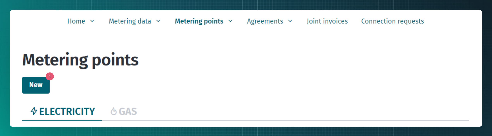
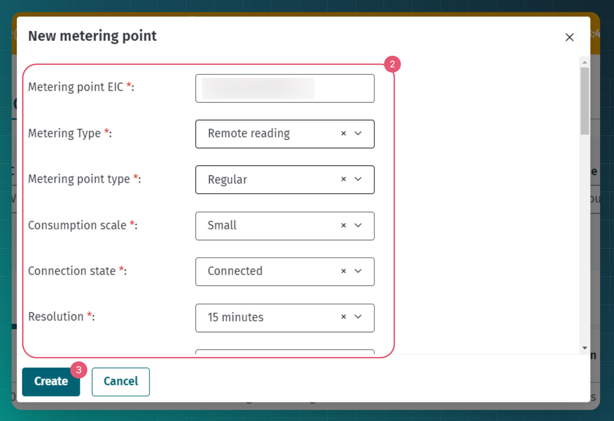
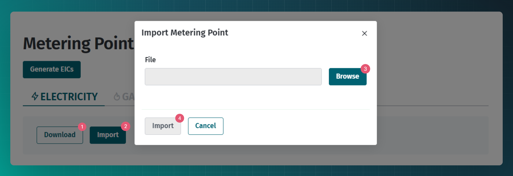
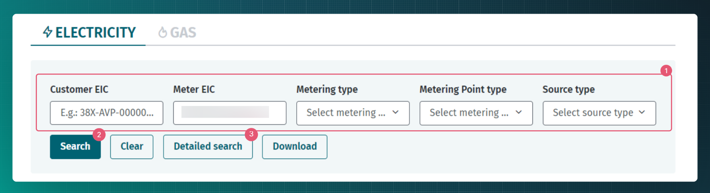

# Mõõtepunktid

## Sisukord

<!-- TOC -->
* [Mõõtepunktid](#mõõtepunktid)
  * [Sisukord](#sisukord)
  * [Sissejuhatus](#sissejuhatus)
  * [Mõõtepunkti andmete edastamine](#mõõtepunkti-andmete-edastamine)
    * [Veebiliides](#veebiliides)
    * [Mõõtepunktide masslaadimine](#mõõtepunktide-masslaadimine)
    * [EIC koodide Masinliidese sõnumid](#eic-koodide-masinliidese-sõnumid)
      * [Sõnumid](#sõnumid)
  * [Elektri mõõtepunkti API andmekoosseis](#elektri-mõõtepunkti-api-andmekoosseis)
    * [Mõõtepunkti V3 andmete edastamine](#mõõtepunkti-v3-andmete-edastamine)
      * [Üldandmed](#üldandmed)
      * [Mõõtepunkti metaandmed](#mõõtepunkti-metaandmed)
      * [Elektri mõõtepunkti spetsiifilised metaandmed](#elektri-mõõtepunkti-spetsiifilised-metaandmed)
      * [Asukohaandmed](#asukohaandmed)
        * [Koordinaadid](#koordinaadid)
      * [V3 versioonis lisandunud atribuudid](#v3-versioonis-lisandunud-atribuudid)
      * [V3 versioonis muudetud reeglid](#v3-versioonis-muudetud-reeglid)
      * [Masinliidese sõnumid V3](#masinliidese-sõnumid-v3)
        * [Sõnumid V3](#sõnumid-v3)
        * [Versioonide info](#versioonide-info-2)
* [Gaasi mõõtepunkti API andmekoosseis](#gaasi-mõõtepunkti-api-andmekoosseis)
  * [Gaasi mõõtepunkti V3 andmete edastamine](#gaasi-mõõtepunkti-v3-andmete-edastamine)
    * [Üldandmed](#üldandmed)
    * [Gaasi mõõtepunkti metaandmed](#gaasi-mõõtepunkti-metaandmed)
    * [Asukohaandmed](#asukohaandmed)
      * [Koordinaadid](#koordinaadid)
    * [V3 versioonis muudetud reeglid](#v3-versioonis-muudetud-reeglid)
    * [Masinliidese sõnumid V3](#masinliidese-sõnumid-v3)
      * [Sõnumid V3](#sõnumid-v3)
      * [GET V3 otsinguparameetrid](#get-v3-otsinguparameetrid)
      * [Versioonide info](#versioonide-info)
* [Agregeerimise mõõtepunkti API andmekoosseis](#agregeerimise-mõõtepunkti-api-andmekoosseis)
  * [Agregeerimise mõõtepunkti V3 andmete edastamine](#agregeerimise-mõõtepunkti-v3-andmete-edastamine)
    * [Üldandmed](#üldandmed-1)
    * [Agregeerimise mõõtepunkti spetsiifilised metaandmed](#agregeerimise-mõõtepunkti-spetsiifilised-metaandmed)
    * [Asukohaandmed](#asukohaandmed-1)
      * [Koordinaadid](#koordinaadid-1)
    * [V3 versioonis muudetud reeglid](#v3-versioonis-muudetud-reeglid-1)
    * [Masinliidese sõnumid V3](#masinliidese-sõnumid-v3-1)
      * [Sõnumid V3](#sõnumid-v3-1)
      * [GET V3 otsinguparameetrid](#get-v3-otsinguparameetrid-1)
      * [Ligipääsureeglid](#ligipääsureeglid)
      * [Versioonide info](#versioonide-info-1)
<!-- TOC -->

## Sissejuhatus

> [!WARNING] 
> NB! 2027 aasta 1. kvartalil võtame kasutusele mõõtepunkti API-de V3 versioonid. Alates mõõtepunkti API V3 versioonidest tulevad elektri-, gaasi- ja agregeerimise mõõtepunktidele eraldi API-d. 
> Mõõtepunkti V2 API-d jäävad peale V3 API-de kasutuselevõttu paralleelselt kasutusele kuueks kuuks. 

Mõõtepunkt on seade, mis mõõdab energia tarbimise ja tootmise koguseid teatud asukohas.

Mõõtepunkte haldavad järgmised turuosalised:

- võrguettevõtja;
- liinivaldaja;
- suletud jaotusvõrgu ettevõtja;
- agregaator;
- tootja;
- laadimispunkti operaator;
- salvestusjaama operaator;
- gaasitankla operaator.

Käesolevas dokumendis nimetatakse neid ühisnimetajaga **Mõõtepunkti haldur**.

Mõõtepunkti haldur vastutab Andmelaos tema piirkonnas olevate mõõtepunktid kohta mõõtepunkti andmete lisamise ja uuendamise eest.

> [!WARNING] 
> NB! Mõõtepunkti haldur on kohustatud mõõtepunkti andmeid uuendama esimesel võimalusel.

## Mõõtepunkti andmete edastamine

Mõõtepunkti haldur saab mõõtepunktide tehnilised andmed edastada Andmelattu:

- ükshaaval veebiliidese või vastava automaatse andmevahetuse liidese kaudu
- masslaadimisega veebiliidese või vastava automaatse andmevahetuse liidese kaudu

Mõõtepunktide andmed on samalaadsed nii andmevahetuse teenustes kui ka veebiliides.

### Veebiliides

Veebiliidese kaudu on elektri-, gaasi-, agregeerimsie mõõtepunkide ükshaaval lisamine, masslaadimine ja pärimine sarnase loogikaga. Alljärgnevad kasutajaliidese piltidega näited on elektri mõõtepunkti näitel. 

Vajadusel on võimalik järgmine vaba mõõtepunkti EIC kood genereerida veebiliidese kaudu navigeerides "Metering points" -> "Metering Point Bulk Import" lehele. Täpsustada tuleb soovitud EIC koodide arv.

Mõõtepunkti lisamiseks veebiliideses on 2 võimalust:

- ükshaaval;
- masslaadimisega.

Ükshaaval laadimiseks tuleks navigeerida "Metering points" lehele.

1. Alustuseks tuleks vajutada nupule "New".
2. Seejärel on vaja avanevas modaalaknas täita kõik kohustuslikud väljad (märgitud tärniga).
3. Kui "Create" nupp on mitteaktiivne on tõenäoliselt jäänud mõni kohustuslik väli täitmata.

Mõõtepunktide masslaadimine on võimalik MS Excel faili abil navigeerides "Metering points" -> "Metering Point Bulk Import" lehele.

1. Vajutades lehel "Download" nupule on võimalik allalaadida template.
2. "Import" nupp avab modaalakna.
3. Seejärel on võimalik lisada mõõtepunki(de) andmetega täidetud fail.

Mõõtepunktide otsimiseks tuleks navigeerida "Metering points" lehele.

1. Soovi korral on võimalik lisada 1 või rohkem otsingukriteeriumit.
2. Ilma ühtegi välja täitmata ja kohe "Search" nuppu vajutades väljastatakse kõigi mõõtepunktide andmed.
Ühe või rohkema otsingukriteeriumi lisamisel väljastatakse vaid nendele kriteeriumitele vastavad mõõtepunktid.
3. Võimalik on otsingut täpsustada täiendavate kriteeriumitega, need valikud avanevad vajutades "Detailed search" nupule.

Peale mõõtepunkti otsingu tulemuste saamist on võimalik:
1. vaadata mõõtepunkti mõõteandmeid;
2. vaadata mõõtepunktiga seotud lepinguid;
3. muuta mõõtepunkti andmeid.

Kirjeldatud on mõõtepunkte haldavate turuosaliste õigused, teistel rollidel mõõtepunkti muutmise õigus puudub.

### Mõõtepunktide masslaadimine

Nii veebiliideses kui ka andmevahetuse liideses on loodud võimalus mõõtepunkide masslaadimiseks MS Excel faili abil. Selleks tuleb veebiliidese või teenuse `template` kaudu laadida alla energikandja liigi spetsiifiline templiit, lisada andmed ning täidetud templiit uuesti veebi või teenuse `import` vahendusel üles laadida.

Mõõtepunkti andmekoosseis on kirjeldatud koos API-dega alljärgnevates peatükkides:
Elekter: [Elektri mõõtepunkti API andmekoosseis](#elektri-mõõtepunkti-api-andmekoosseis)
Gaas: [Gaasi mõõtepunkti API andmekoosseis](#gaasi-mõõtepunkti-api-andmekoosseis)
Agregeerimine: [Agregeerimise mõõtepunkti API andmekoosseis](#agregeerimise-mõõtepunkti-api-andmekoosseis)

### EIC koodide Masinliidese sõnumid

#### Sõnumid

| Sõnum                      | Eesmärk                                             |
|-------------------------------|-----------------------------------------------------|
| `POST /api/v1/eic/amount`                            | **Enda** EIC vahemikust vabade EIC koodide otsing   |
| `POST /api/v1/eic/range`                        | Turusalise **enda** EIC koodi vahemike otsing       |

# Elektri mõõtepunkti API andmekoosseis

## Mõõtepunkti V3 andmete edastamine

### Üldandmed

| Atribuut teenuses | V2 | V3 | Kommentaar |
|-------------------|----|----|------------|
| eic | jah | jah | Mõõtepunkti EIC kood |
| meteringPointType | jah | jah | Mõõtepunkti tüüp |
| meteringType | jah | jah | Mõõtmise viis |
| characteristics | jah | jah | Elektri mõõtepunkti metaandmed |
| location | jah | jah | Mõõtepunkti asukohaandmed |

### mõõtepunkti metaandmed

| Atribuut teenuses | Kohustuslik V2 versioonis? | Kohustuslik V3 versioonis? | Muud reeglid |
|-------------------|---------------------------|---------------------------|-------------|
| consumptionScale | jah | jah | SMALL, LARGE |
| connectionState | jah | jah | CONNECTED, DISCONNECTED |
| resolution | jah | jah | V2: PT15M (15 minutit), PT1H (1 tund), V3: 15_MINUTES  |
| customerType | jah | jah | Üks neist:  CONSUMER (tarbija), GRID_OPERATOR (võrguettevõtja), PRODUCER (tootja), MICRO (mikrotootja), LINE_OPERATOR (liinivaldaja), ENERGY_STORAGE_UNIT (salvestusjaam), CHARGING_POINT_OPERATOR (laadimispunkti operaator) |
| production | jah | jah | TRUE/FALSE |
| apartmentAssociation | jah | jah | TRUE/FALSE |

### Elektri mõõtepunkti spetsiifilised metaandmed

| Atribuut teenuses | Tulba nimetus masslaadimise templiidis | Selgitus | Kohustuslik V2 versioonis? | Kohustuslik V3 versioonis? | Muud reeglid |
|-------------------|----------------------------------------|----------|----------------------------|----------------------------|--------------|
| productionSource  | Production Source | energia tootmise allikas | jah, kui production=true | jah, kui production=true | Üks neist: SOLAR (päike), WIND (tuul), HYDRO (vesi), BIOGAS (biogaas), BIOMASS (biomass), NATURAL_GAS (gaas), OIL_SHALE (põlevkivi), OTHER_RENEWABLE (muu taastuv), OTHER_NON_RENEWABLE (muu mittetaastuv). |
| transmissionNetworkEic | Transmission Network EIC | ülekandevõrgu 16 kohaline EIC kood | jah | ei | Määratud ülekandevõrgu EIC kood peab eksisteerima süsteemis. Energiakandja tüüp peab ühtima mõõtepunkti omaga. Koodi puudumisel võib kasutada koodi 38A-1234567890-1. V3 versioonis ei ole kohustuslik |
| isolatedMeteringPoint | Isolated Metering Point | kas tegemist on isoleeritud mõõtepunktiga | jah | jah | Üks neist: TRUE (jah), FALSE (ei) |
| electricalHeating | Electrical Heating | kas mõõtepunktis toimub elektriga kütmist | jah | jah | Üks neist: TRUE (jah), FALSE (ei) |
| chargingPoint | Charging Point | kas mõõtepunktis toimub elektri laadimist | jah | jah | Üks neist: TRUE (jah), FALSE (ei) |
| storageCapacity | Storage Capacity | energiasalvestusvõimsus (kW) | jah | jah | Peab olema täis- või komakohaga (max. 2 komakohta) number. |
| storageEnergy | Storage Energy | energiasalvesti mahtuvus (kWh) | jah | jah | Peab olema täis- või komakohaga (max. 2 komakohta) number. |
| productionCapacity | Production Capacity | tootmise maht (kW) | jah | jah | Peab olema täis- või komakohaga (max. 2 komakohta) number. |
| transmissionCapacity | Transmission Capacity | ülekande maht (kW) | jah | jah | Peab olema täis- või komakohaga (max. 2 komakohta) number. |
| esuScheme | ESU Scheme | energiasalvesti skeem | atribuut puudub | ei | Üks neist: STANDALONE (eraldiseisev salvesti), PRODUCTION (salvesti + tootmine), CONSUMPTION (salvesti + tarbimine), HYBRID (Salvesti + tootmine + tarbimine) |
| esuSchemeValidFrom | ESU Scheme Valid From | energiasalvesti skeemi kehtivuse algus | atribuut puudub | ei | Energiasalvesti skeemi algus päeva täpsusega |
| esuQuantitiesProvider | ESU Quantities Provider | energiasalvesti mõõteandmete esitaja | atribuut puudub | ei | Üks neist: OWNER (omanik), CUSTOMER (mõõtepunkti klient) |
| esuBilling | ESU Billing | energiasalvesti arveldusskeemi kasutamine | atribuut puudub | ei | Üks neist: TRUE (jah), FALSE (ei). |
| esuBillingValidFrom | ESU Billing Valid From | energiasalvesti arveldusskeemi kehtivuse algus | atribuut puudub | ei | Energiasalvesti arvelsusskeemi algus päeva täpsusega |
| bidirectional | Bidirectional | kas mõõtepunkt on kahesuunaline | atribuut puudub | ei | Üks neist: TRUE (jah), FALSE (ei). |
| bidirectionalChangeTime | Bidirectional Change Time | kahesuunalisuse muudatuse aeg | atribuut puudub | ei | Kellaaeg peab olema 15-minutilise täpsusega, minutite väärtus peab olema: 00, 15, 30 või 45. Sekundite väärtus peab alati olema 00. |

### Asukohaandmed

| Atribuut teenuses | Kohustuslik V2 versioonis? | Kohustuslik V3 versioonis? | Kommentaar |
|-------------------|---------------------------|---------------------------|------------|
| adrId | ei | ei | ADS aadressi identifikaator |
| comment | ei | ei | Kommentaar |
| county | jah | jah | Maakond, peab ühtima EHAK level 1 |
| municipality | jah | jah | Omavalitsus, peab ühtima EHAK level 2-ga ja sisalduma level 1-s |
| locality | ei | tingimuslik | V3-s kohustuslik kui EHAK tase 3 on olemas. Peab sisalduma level 3-s ja sisalduma EHAK level 2-s |
| streetAddress | jah | jah | Tänav, maja, korter (ADS levels 4-8) |
| postcode | jah | jah | Sihtnumber |
| coordinates | ei | ei | Koordinaadid |

#### Koordinaadid

| Atribuut teenuses | Kohustuslik V2 versioonis? | Kohustuslik V3 versioonis? | Kommentaar |
|-------------------|---------------------------|---------------------------|------------|
| latitude | jah, kui coordinates on täidetud | jah, kui coordinates on täidetud | Laiuskraad |
| longitude | jah, kui coordinates on täidetud | jah, kui coordinates on täidetud | Pikkuskraad |
| coordinateSystem | jah, kui coordinates on täidetud | jah, kui coordinates on täidetud | WGS84 või LEST97 |

### V3 versioonis lisandunud atribuudid

| Atribuut | Kirjeldus |
|-----------|-----------|
| esuScheme | Energiasalvesti skeem |
| esuSchemeValidFrom | Energiasalvesti skeemi jõustumise kuupäev |
| esuQuantitiesProvider | Energiasalvesti koguste esitaja |
| esuBilling | Energiasalvesti arveldusloogika |
| esuBillingValidFrom | Energiasalvesti arvelduse jõustumise kuupäev |
| bidirectional | Kahesuunaline mõõtepunkt |
| bidirectionalChangeTime | Kahesuunalisuse muudatuse aeg |

### V3 versioonis muudetud reeglid

| Atribuut | Muudatus |
|-----------|----------|
| transmissionNetworkEic | Kohustuslik → vabatahtlik |
| resolution | Kasutab ainult 15_MINUTES enumit |
| API struktuur | Üldine mõõtepunkti API jagati elektri-, gaasi- ja agregeerimise API-deks |

### Masinliidese sõnumid V3 

#### Sõnumid V3

 | Sõnum                      | Eesmärk                                             |
|-------------------------------|-----------------------------------------------------|
| `POST /api/V3/metering-points/electricity`          | Mõõtepunkti lisamine                                |
| `PUT /api/V3/metering-points/electricity/{eic}`     | Mõõtepunkti muutmine                                |
| `GET /api/V3/metering-points/electricity/{eic}` | Mõõtepunkti otsimine|
| `GET /api/V3/customers/{customerEic}/metering-points/electricity` | mõõtepunkti otsimine kliendi alusel ka juhul, kui päringu tegijal puudub tavapärase protsessi raames mõõtepunktile juurdepääsuõigus. Seda kasutatakse uue lepingu lisamisel avatud tarnija (Open Supplier) poolt |

#### Versioonide info

V3 versiooni lisandumisel toimusid järgmised muudatused:
  - V3 versioonis lisandusid elektri mõõtepunktile 7 uut atribuuti: `esuScheme`, `esuSchemeValidFrom`, `esuQuantitiesProvider`, `esuBilling`, `esuBillingValidFrom`, `bidirectional`, `bidirectionalChangeTime`. 
  - V3 versioonis muutusid asukoha ja elektri mõõtepunkti spetsiifiliste atribuutide kohustuslikkuse reeglid
  
## Gaasi mõõtepunkti API andmekoosseis

### Gaasi mõõtepunkti V3 andmete edastamine

#### Üldandmed

| Atribuut teenuses | V2 | V3 | Kommentaar |
|-------------------|----|----|------------|
| eic | jah | jah | Mõõtepunkti EIC kood. PUT V3 päringus edastatakse EIC path-parameetrina. |
| meteringPointType | jah | jah | Mõõtepunkti tüüp. Lubatud väärtused: REGULAR ja BORDER. |
| meteringType | jah | jah | Mõõtmise viis. |
| characteristics | jah | jah | Gaasi mõõtepunkti metaandmed. |
| location | jah | jah | Mõõtepunkti asukohaandmed. |

POST-päringus peab `eic` kuuluma turuosalisele eraldatud EIC-vahemikku ning sama EIC koodiga mõõtepunkt ei tohi juba süsteemis eksisteerida.  
PUT-päringus peab URL-is esitatud mõõtepunkt eksisteerima, kuuluma päringu tegijale ja olema energiakandja tüübiga `NATURAL_GAS`.

Gaasi mõõtepunkti loomisel kehtivad järgmised tururollide reeglid:
- `BORDER` mõõtepunkti saab luua ainult `GRID_OPERATOR`;
- `REGULAR` mõõtepunkti saavad luua `GRID_OPERATOR`, `PRODUCER_OPERATOR`, `STORAGE_OPERATOR` ja `GAS_STATION_OPERATOR`;
- `AGGREGATOR` roll ei saa gaasi mõõtepunkti luua ega muuta.

#### Gaasi mõõtepunkti metaandmed

| Atribuut teenuses | Kohustuslik V2 versioonis? | Kohustuslik V3 versioonis? | Muud reeglid |
|-------------------|----------------------------|----------------------------|--------------|
| consumptionScale | jah | jah | SMALL, LARGE |
| connectionState | jah | jah | CONNECTED, DISCONNECTED |
| resolution | jah | jah | V2: PT1H (1 tund), PT1D (1 päev). V3: HOUR, DAY. |
| customerType | jah | jah | Üks neist: CONSUMER, CONSUMER_2, GRID_OPERATOR, PRODUCER, PROTECTED, PROTECTED_OTHER, GENERAL_INTEREST_SERVICE_PROVIDER, POWER_PRODUCER_FROM_GAS. |
| production | jah | jah | TRUE/FALSE |
| apartmentAssociation | jah | jah | TRUE/FALSE |

V3 API kasutab gaasi mõõtepunktidele eraldi `NaturalGasMeteringPointResolution` enumit. Väärtused teisendatakse Andmelaos järgmiselt:
- `HOUR` ↔ `PT1H`;
- `DAY` ↔ `PT1D`.

#### Asukohaandmed

| Atribuut teenuses | Kohustuslik V2 versioonis? | Kohustuslik V3 versioonis? | Kommentaar |
|-------------------|----------------------------|----------------------------|------------|
| adrId | ei | ei | ADS aadressi identifikaator. |
| comment | ei | ei | Kommentaar. |
| county | jah | jah | Maakond, peab ühtima aktiivse EHAK taseme 1 üksusega. |
| municipality | jah | jah | Omavalitsus, peab ühtima aktiivse EHAK taseme 2 üksusega ja kuuluma määratud maakonda. |
| locality | ei | tingimuslik | V3-s kohustuslik, kui määratud omavalitsusel on EHAK taseme 3 üksus. Väärtus peab kuuluma määratud omavalitsusse. |
| streetAddress | jah | jah | Tänav, maja, korter või muud ADS tasemed 4-8. |
| postcode | jah | jah | Sihtnumber. Kui õige sihtnumber ei ole teada, kasutatakse väärtust 00000. |
| coordinates | ei | ei | Koordinaadid. |

##### Koordinaadid

| Atribuut teenuses | Kohustuslik V2 versioonis? | Kohustuslik V3 versioonis? | Kommentaar |
|-------------------|----------------------------|----------------------------|------------|
| latitude | jah, kui coordinates on täidetud | jah, kui coordinates on täidetud | Laiuskraad. |
| longitude | jah, kui coordinates on täidetud | jah, kui coordinates on täidetud | Pikkuskraad. |
| coordinateSystem | jah, kui coordinates on täidetud | jah, kui coordinates on täidetud | WGS84 või LEST97. |

#### V3 versioonis muudetud reeglid

| Atribuut | Muudatus |
|----------|----------|
| API struktuur | Üldine mõõtepunkti API jagati elektri-, gaasi- ja agregeerimise API-deks. |
| sourceType | Atribuut eemaldati. Ligipääs määratakse tururolli, mõõtepunkti omandi, lepingute ja kliendi antud volituste alusel. |
| resolution | V3 kasutab gaasi mõõtepunkti spetsiifilist enumit väärtustega HOUR ja DAY. |
| locality | V3-s kohustuslik, kui määratud omavalitsusel on EHAK taseme 3 üksus. |
| Asukohaandmete valideerimine | county, municipality ja locality valideeritakse aktiivse EHAK klassifikaatori vastu. |

#### Masinliidese sõnumid V3

##### Sõnumid V3

| Sõnum | Eesmärk |
|-------|---------|
| POST /api/v3/metering-points/natural-gas | Gaasi mõõtepunkti lisamine. |
| PUT /api/v3/metering-points/natural-gas/{eic} | Gaasi mõõtepunkti muutmine. |
| GET /api/v3/metering-points/natural-gas | Gaasi mõõtepunktide otsimine. |
| GET /api/v3/customers/{customerEic}/metering-points/natural-gas | Kliendi gaasi mõõtepunktide otsimine uue lepingu loomisel ka juhul, kui päringu tegijal puudub tavapärase protsessi alusel mõõtepunktile juurdepääs. |

##### GET V3 otsinguparameetrid

`GET /api/v3/metering-points/natural-gas` võimaldab kasutada järgmisi otsinguparameetreid:
- `eic`;
- `meteringPointType`;
- `meteringType`;
- `customerEic`;
- `viewMode`;
- `hasCustomerAuthorization`;
- `consumptionScale`;
- `connectionState`;
- `resolution`;
- `customerType`;
- `production`;
- `apartmentAssociation`;
- `location.adrId`;
- `location.location`;
- `location.comment`;
- `page`;
- `size`.

Mitme otsinguparameetri kasutamisel ühendatakse tingimused loogilise `AND`-iga. `page` väärtus algab nullist ja `size` maksimaalne väärtus on 500.

##### Versioonide info

V3 versiooni lisandumisel toimusid järgmised muudatused:
- üldine mõõtepunkti API jagati elektri-, gaasi- ja agregeerimise API-deks;
- gaasi mõõtepunktidele lisandus eraldi `NaturalGasMeteringPointResolution` enum;
- V3 API-st eemaldati `sourceType` atribuut;
- asukohaandmete EHAK-põhist valideerimist täpsustati.

---

## Agregeerimise mõõtepunkti API andmekoosseis

Agregeerimise mõõtepunkt on elektri energiakandjaga mõõtepunkt, mille tüüp on alati `AGGREGATION`. API kasutamisel peab `x-commodity-type` olema `ELECTRICITY` ja tururoll `AGGREGATOR`.

Täispikk juhend on agregeerimismõõtepunkti lisamise kohta on saadaval [siin](https://elering.ee/sites/default/files/2026-06/Iseseisva%20agregaatori%20reguleerimisandmete%20esitamise%20juhend%20Estfeed%20Datahubis.pdf).

### Agregeerimise mõõtepunkti V3 andmete edastamine

#### Üldandmed

| Atribuut teenuses | V2 | V3 | Kommentaar |
|-------------------|----|----|------------|
| eic | jah | jah | Mõõtepunkti EIC kood. PUT V3 päringus edastatakse EIC path-parameetrina. |
| meteringPointType | jah | API määrab | Väärtus on alati AGGREGATION ja seda ei edastata POST või PUT päringu kehas. |
| meteringType | jah | jah | Mõõtmise viis. |
| characteristics | jah | jah | Agregeerimise mõõtepunkti metaandmed. |
| location | jah | jah | Mõõtepunkti asukohaandmed. |

POST-päringus peab `eic` kuuluma agregaatorile eraldatud EIC-vahemikku ning sama EIC koodiga mõõtepunkt ei tohi juba süsteemis eksisteerida.  
PUT-päringus peab URL-is esitatud mõõtepunkt eksisteerima, kuuluma päringu tegijale, olema energiakandja tüübiga `ELECTRICITY` ja mõõtepunkti tüübiga `AGGREGATION`.

#### Agregeerimise mõõtepunkti spetsiifilised metaandmed

| Atribuut teenuses | Kohustuslik V2 versioonis? | Kohustuslik V3 POST-is? | V3 PUT reegel | Muud reeglid |
|-------------------|----------------------------|-------------------------|---------------|--------------|
| parentMeteringPointEic | jah | jah | Ei ole PUT päringu kehas ja seda ei saa muuta. | Peab viitama süsteemis registreeritud REGULAR mõõtepunktile, mille omanik on GRID_OPERATOR või CLOSED_DISTRIBUTION_NETWORK. Ülemmõõtepunkt peab olema sama energiakandja tüübiga. |
| aggregationProductType | jah | jah | Väärtust saab lisada ainult juhul, kui eelnev väärtus puudub. | Üks neist: MFRR, AFRR, FCR, D1, D, LOCAL_PRODUCT. |
| assetType | jah | jah | Väärtust saab lisada ainult juhul, kui eelnev väärtus puudub. | CONSUMPTION või PRODUCTION. |
| aggregationProductionType | jah, kui assetType=PRODUCTION | jah, kui assetType=PRODUCTION | Väärtust saab lisada ainult juhul, kui eelnev väärtus puudub. | Lubatud ainult juhul, kui assetType=PRODUCTION. Üks neist: BESS, BV, WIND, HYDRO, OTHER. |
| resourceEic | jah | jah | Väärtust saab lisada ainult juhul, kui eelnev väärtus puudub. | Ressursi EIC kood peab vastama EIC vormingule ja kuuluma agregaatorile. |

#### Asukohaandmed

| Atribuut teenuses | Kohustuslik V2 versioonis? | Kohustuslik V3 versioonis? | Kommentaar |
|-------------------|----------------------------|----------------------------|------------|
| adrId | ei | ei | ADS aadressi identifikaator. |
| comment | ei | ei | Kommentaar. |
| county | jah | jah | Maakond, peab ühtima aktiivse EHAK taseme 1 üksusega. |
| municipality | jah | jah | Omavalitsus, peab ühtima aktiivse EHAK taseme 2 üksusega ja kuuluma määratud maakonda. |
| locality | ei | tingimuslik | V3-s kohustuslik, kui määratud omavalitsusel on EHAK taseme 3 üksus. |
| streetAddress | jah | jah | Tänav, maja, korter või muud ADS tasemed 4-8. |
| postcode | jah | jah | Sihtnumber. Kui õige sihtnumber ei ole teada, kasutatakse väärtust 00000. |
| coordinates | ei | ei | Koordinaadid. |

##### Koordinaadid

| Atribuut teenuses | Kohustuslik V2 versioonis? | Kohustuslik V3 versioonis? | Kommentaar |
|-------------------|----------------------------|----------------------------|------------|
| latitude | jah, kui coordinates on täidetud | jah, kui coordinates on täidetud | Laiuskraad. |
| longitude | jah, kui coordinates on täidetud | jah, kui coordinates on täidetud | Pikkuskraad. |
| coordinateSystem | jah, kui coordinates on täidetud | jah, kui coordinates on täidetud | WGS84 või LEST97. |

#### V3 versioonis muudetud reeglid

| Atribuut | Muudatus |
|----------|----------|
| API struktuur | Agregeerimise mõõtepunktidele loodi eraldi API. |
| sourceType | Atribuut eemaldati. Ligipääs määratakse tururolli, mõõtepunkti omandi, lepingute ja kliendi antud volituste alusel. |
| meteringPointType | API määrab väärtuseks alati AGGREGATION. |
| parentMeteringPointEic | Esitatakse POST päringus, kuid puudub PUT päringu kehast ja seda ei saa tavapärase PUT päringuga muuta. |
| Metaandmete muutmine | aggregationProductType, assetType, aggregationProductionType ja resourceEic väärtusi saab lisada ainult juhul, kui eelnev väärtus puudub. |
| locality | V3-s kohustuslik, kui määratud omavalitsusel on EHAK taseme 3 üksus. |

#### Masinliidese sõnumid V3

##### Sõnumid V3

| Sõnum | Eesmärk |
|-------|---------|
| POST /api/v3/metering-points/aggregation | Agregeerimise mõõtepunkti lisamine. |
| PUT /api/v3/metering-points/aggregation/{eic} | Agregeerimise mõõtepunkti muutmine. |
| GET /api/v3/metering-points/aggregation | Agregeerimise mõõtepunktide otsimine. |

Agregeerimise mõõtepunktidele ei ole eraldi `GET /customers/{customerEic}/metering-points/aggregation` teenust. Kliendi järgi saab otsida tavapärase GET teenuse `customerEic` parameetriga.

##### GET V3 otsinguparameetrid

`GET /api/v3/metering-points/aggregation` võimaldab kasutada järgmisi otsinguparameetreid:
- `eic`;
- `meteringType`;
- `customerEic`;
- `viewMode`;
- `parentMeteringPointEic`;
- `hasCustomerAuthorization`;
- `aggregationProductType`;
- `assetType`;
- `aggregationProductionType`;
- `resourceEic`;
- `location.adrId`;
- `location.location`;
- `location.comment`;
- `page`;
- `size`.

Mitme otsinguparameetri kasutamisel ühendatakse tingimused loogilise `AND`-iga. API tagastab ainult `AGGREGATION` tüüpi mõõtepunkte. `page` väärtus algab nullist ja `size` maksimaalne väärtus on 500.

##### Ligipääsureeglid

Kui `hasCustomerAuthorization=true`, tagastatakse ainult mõõtepunktid, millele päringu tegijal on Kliendiportaali kaudu antud kehtiv volitus.

Kui `hasCustomerAuthorization=false`, rakenduvad järgmised põhireeglid:
- `AGGREGATOR` näeb talle kuuluvaid agregeerimise mõõtepunkte;
- `GRID_OPERATOR` ja `CLOSED_DISTRIBUTION_NETWORK` näevad agregeerimise mõõtepunkte, mille ülemmõõtepunkt neile kuulub;
- `OPEN_SUPPLIER` ligipääs sõltub mõõtepunktiga seotud lepingutest ja mõõtepunkti ligipääsureeglitest;
- teistele tururollidele agregeerimise mõõtepunkte ei tagastata.

Kui `customerEic` on esitatud, tagastatakse mõõtepunktid, kus kliendil on päringu tegemise hetkel aktiivne agregeerimise leping.

##### Versioonide info

V3 versiooni lisandumisel toimusid järgmised muudatused:
- agregeerimise mõõtepunktidele loodi eraldi API;
- V3 API-st eemaldati `sourceType` atribuut;
- mõõtepunkti tüüp määratakse API poolt väärtuseks `AGGREGATION`;
- täpsustati agregeerimise metaandmete muutmise piiranguid;
- asukohaandmete EHAK-põhist valideerimist täpsustati.
